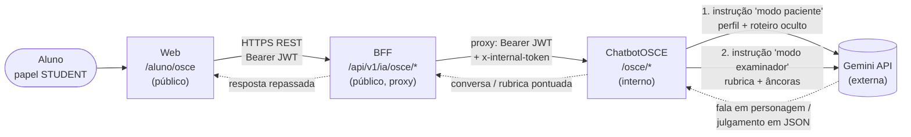

# Chatbot de simulação OSCE

> Documento de implementação: descreve a feature **já entregue**, não um plano. A simulação roda no microsserviço **ChatbotOSCE**, que chama a Gemini; o BFF só faz proxy de `/api/v1/ia/osce/*` para ele (ver a [DA-07](decisoes.md) revisada). O chat de ajuda (`/ia/perguntar`) e a dica continuam no BFF.

## 1. O que é e por que existe

OSCE (*Objective Structured Clinical Examination*) é o formato de avaliação clínica usado em cursos de medicina: o estudante entra numa "estação" com um paciente (real, ator ou simulado) e precisa colher a história clínica (anamnese) e levantar hipóteses diagnósticas, sem o paciente simplesmente dizer qual é a doença.

A feature replica isso dentro do AnatoQuizUp: o aluno escolhe um **caso clínico**, conversa em texto no papel de médico, e a IA interpreta o paciente — respondendo só o que for perguntado, nunca entregando o diagnóstico. Ao final, o aluno pede uma **avaliação**, e a mesma IA troca de papel para "examinador", julgando a conversa contra a **rubrica** do caso — e o ChatbotOSCE transforma esse julgamento em pontuação (seção 5). Como num OSCE real, saem duas medidas: o checklist ponderado e uma nota global independente. Nas telas isso aparece como **feedback**: "rubrica" é o nome do instrumento de avaliação, não do que o aluno lê.

O escopo e as escolhas técnicas desta feature foram alinhados com os Product Owners na [ata de 26/10/2026](../reunioes/reuniao-26-10-26.md): chatbot orientado por casos e protocolos estruturados, Gemini como solução de curto prazo com a integração desacoplada, avaliação por rubricas derivadas do protocolo OSCE, casos como dado estruturado sem fine-tuning nem RAG documental, e primeira versão sem imagens clínicas.

## 2. Arquitetura



O BFF valida o JWT na borda e repassa a chamada com `criarProxyHandler` (`src/routes/index.ts`), reescrevendo `/api/v1/ia/osce` para `/osce`. O ChatbotOSCE só aceita chamadas com o `x-internal-token` do BFF e valida o JWT de novo. As duas chamadas à Gemini usam o mesmo `geminiClient` e a `GEMINI_API_KEY` **do ChatbotOSCE**; o que muda entre elas é só a instrução de sistema (seção 4). A chave fica no ChatbotOSCE e nunca chega ao BFF nem ao Web.

Não há RAG/Qdrant aqui. O conteúdo de cada caso é pequeno e fixo (ver seção 3), então ele cabe inteiro no prompt da Gemini. Reavaliar RAG só se a biblioteca de casos crescer muito.

### Componentes tocados

| Repositório | Arquivo | Papel |
|---|---|---|
| ChatbotOSCE | `src/shared/constants/cenarios-osce.ts` | Os casos clínicos (parametrização, seção 3) |
| ChatbotOSCE | `src/routes/osce.routes.ts` | As 3 rotas HTTP, montadas em `/osce` (seção 4) |
| ChatbotOSCE | `src/shared/utils/pontuacao-osce.ts` | Pesos, soma, percentual, teto do item crítico e divergência checklist×nota global (seção 5) |
| BFF | `src/routes/index.ts` | Proxy de `/ia/osce/*` para o ChatbotOSCE, montado **antes** de `/ia` (o catch-all de `ia.routes.ts` intercepta qualquer sub-rota não mapeada de `/ia/*`) |
| Web | `src/features/osce/osceService.ts` | Chamadas HTTP às 3 rotas |
| Web | `src/features/osce/detectarDespedida.ts` | Detecta despedida ou pedido de encerramento na fala do aluno (seção 4.4) |
| Web | `src/pages/aluno/osce/OscePage.tsx` | Tela: lista de casos → cenário → chat → feedback |
| Web | `src/pages/aluno/osce/CenarioApresentacao.tsx` | Etapa de cenário, antes do chat (seção 4.4) |
| Web | `src/pages/aluno/osce/ModalConfirmarEncerramento.tsx` | Confirmação "Encerrar e ver avaliação?" (seção 4.4) |
| Web | `src/pages/aluno/osce/FeedbackResultado.tsx` | Painel do feedback: as duas medidas, domínios e item a item |
| Web | `src/app/router.tsx` | Rota `/aluno/osce`, protegida para `STUDENT` |
| Web | `src/widgets/header/ui/Header.tsx` | Item de menu "Simulação OSCE" (ícone `Stethoscope`) |

## 3. Parametrização: o que é um "cenário"

Cada caso clínico é um objeto `CenarioOsce` (`src/shared/constants/cenarios-osce.ts` no ChatbotOSCE):

| Campo | Visível para o aluno? | Uso |
|---|---|---|
| `id` | Sim | Identifica o caso nas rotas (`/api/v1/ia/osce/:id/...`) |
| `titulo` | Sim | Nome exibido na lista de casos |
| `especialidade` | Sim | Rótulo exibido (ex.: "Cardiologia") |
| `dificuldade` | Sim | `"Fácil" \| "Médio" \| "Difícil"`, exibido como selo colorido |
| `contextoInicial` | Sim | `{ local, papelEstudante, idade, sexo, queixa }`, exibido na etapa de cenário antes do chat (seção 4.4) |
| `perfilPaciente` | **Não** | Idade, sexo, profissão, jeito de falar — molda o tom das respostas da IA |
| `queixaPrincipal` | **Não** | O que o paciente diz se perguntado "o que você está sentindo?" |
| `historiaSintomas` | **Não** | História, sintomas e antecedentes que o paciente conhece — a IA só revela o que for perguntado |
| `exameFisico` | Só quando o aluno pede | Achados do exame físico, devolvidos literalmente do cadastro (seção 4.5). Não entra no prompt do paciente |
| `exames` | Só quando o aluno pede | Exames complementares `{ nome, resultado }`, devolvidos literalmente do cadastro (seção 4.5). Do prompt, só os nomes |
| `diagnosticoEsperado` | **Não** | Nunca é dito ao aluno; só aparece no feedback final |
| `rubrica` | **Não** (só após finalizar) | Checklist pontuado: itens, domínios, pesos, âncoras de crédito e itens críticos (ver seção 5) |

A rota `GET /api/v1/ia/osce/cenarios` devolve **só** os 5 primeiros campos — o resto nunca sai do ChatbotOSCE antes da hora, para não vazar a resposta do caso.

O `contextoInicial` é escrito à mão em cada caso, sem ser gerado a partir do `perfilPaciente`. Ele traz só o local, o papel do estudante, a idade, o sexo e uma queixa curta e neutra (ex.: "Dor abdominal"). Não pode trazer profissão, temperamento nem pistas do roteiro ou do diagnóstico, e a queixa não repete o `queixaPrincipal`, que é a fala do paciente no roteiro. Idade e sexo precisam bater com o `perfilPaciente` do mesmo caso. Os testes de integração do ChatbotOSCE verificam essas regras.

Hoje há 3 casos fixos (dor torácica/cardiologia, cefaleia súbita/neurologia, dor abdominal/apendicite) no próprio código — o número e a ausência de imagens seguem o combinado na [ata de 26/10/2026](../reunioes/reuniao-26-10-26.md), que prevê cerca de três casos autorais do Product Owner como base para as variações. **Não há tela de autoria de caso para professor** — decisão deliberada (YAGNI): construir CRUD de casos sem uma demanda real validada seria antecipar um requisito que ninguém pediu ainda. Para adicionar um caso novo hoje, basta um objeto novo no array `CENARIOS_OSCE`, seguindo os 3 exemplos existentes como modelo.

## 4. Como funciona (fluxo e contratos)

Pré-requisitos:
- `GEMINI_API_KEY`/`GEMINI_MODEL` configurados no ChatbotOSCE (`src/config/env.ts`). Sem a chave, `mensagem` e `finalizar` respondem `503 IA_INDISPONIVEL`, vindo do ChatbotOSCE e repassado pelo BFF.
- No BFF, `CHATBOT_OSCE_URL` apontando para o ChatbotOSCE (porta padrão `3335`) e o mesmo `INTERNAL_TOKEN` dos dois lados.

As rotas públicas ficam no BFF atrás do `middlewareAutenticacao` (JWT validado na borda, como manda o [DA-03](decisoes.md)). No ChatbotOSCE, as mesmas rotas exigem o `x-internal-token` e o JWT. A tela `/aluno/osce` é protegida para o papel `STUDENT` no `router.tsx` do Web. Nenhum segredo do provedor entra na resposta: o Web nunca fala com a Gemini nem com o ChatbotOSCE, só com o BFF.

Os caminhos abaixo são os públicos, no BFF. No ChatbotOSCE eles ficam em `/osce/...`.

### 4.1. `GET /api/v1/ia/osce/cenarios`

Lista os casos disponíveis (campos públicos da tabela acima). Sem corpo de requisição.

```json
{
  "cenarios": [
    {
      "id": "dor-toracica",
      "titulo": "...",
      "especialidade": "Cardiologia",
      "dificuldade": "Médio",
      "contextoInicial": {
        "local": "Pronto-socorro de um hospital geral",
        "papelEstudante": "Médico(a) responsável pelo primeiro atendimento",
        "idade": 58,
        "sexo": "Masculino",
        "queixa": "Dor torácica"
      }
    }
  ]
}
```

No Web, `contextoInicial` é tratado como opcional: se o Web for publicado antes do ChatbotOSCE, a etapa de cenário mostra um texto padrão no lugar.

### 4.2. `POST /api/v1/ia/osce/:id/mensagem` — uma fala do aluno

```json
{
  "mensagem": "Vou pedir um ECG.",
  "historico": [
    { "autor": "aluno" | "paciente", "texto": "..." },
    { "autor": "exame" | "indisponivel", "exame": "Eletrocardiograma", "texto": "..." }
  ]
}
```

O ChatbotOSCE monta a chamada à Gemini com:
- **Instrução de sistema** = perfil + queixa + `historiaSintomas` do caso e os **nomes** dos exames cadastrados, mais as regras "só fale o que está na história; fora dela diga que não sabe", "nunca diga o nome do diagnóstico", "você não conhece resultados de exames nem sinais vitais" e a regra de encerramento (seção 4.4). O exame físico e os resultados **não** entram na instrução.
- **`contents`** = o `historico` recebido, convertido em turnos `user` (aluno) / `model` (paciente), mais a nova `mensagem` como último turno. Os cards de exame entram só como uma nota de que o médico recebeu o resultado, sem o resultado.
- **`responseSchema`** = JSON com `fala`, `pediuExameFisico`, `examesSolicitados` (enum com os nomes cadastrados) e `examesNaoCadastrados` (seção 4.5).

O **histórico vive no front** (estado React da página), não no backend — cada chamada reenvia a conversa inteira, do mesmo jeito que o `ChatAjudaModal` já faz para as perguntas livres. Isso mantém o ChatbotOSCE sem estado de sessão a gerenciar.

Resposta:

```json
{
  "resposta": "Tudo bem, doutor.",
  "turnos": [
    { "autor": "paciente", "texto": "Tudo bem, doutor." },
    { "autor": "exame", "exame": "Eletrocardiograma", "texto": "<resultado cadastrado>" },
    { "autor": "indisponivel", "exame": "Tomografia de tórax", "texto": "Não disponível neste caso." }
  ]
}
```

`resposta` continua sendo só a fala do paciente (contrato anterior); a tela usa `turnos`, na ordem em que aparecem no chat. Se o modelo não devolver JSON válido, ou não devolver fala nem exame, a rota responde `502`.

### 4.3. `POST /api/v1/ia/osce/:id/finalizar` — fim da simulação

```json
{ "historico": [{ "autor": "aluno" | "paciente", "texto": "..." }] }
```

Troca a instrução de sistema para o modo "examinador": a IA sai do personagem de paciente, recebe o `diagnosticoEsperado` e a `rubrica` do caso (cada item com suas **âncoras de crédito**) e produz **duas medidas independentes**, nesta ordem:

1. **Checklist** — classifica cada item em `competente` / `parcial` / `nao_realizado`, com justificativa citando a fala do aluno.
2. **Nota global (GRS)** — julga o desempenho como um todo, de 0 a 4, *sem* somar o checklist.

A resposta é forçada a JSON pelo `responseSchema` nativo da Gemini e validada com Zod no ChatbotOSCE — JSON inválido vira `502`, nunca uma nota silenciosamente errada.

**A IA não calcula nota.** Pesos, soma, percentual, teto do item crítico e a verificação de concordância entre as duas medidas são aplicados em código (`pontuacao-osce.ts`), porque modelo de linguagem não é confiável para aritmética e porque a regra de aprovação precisa ser auditável.

Resposta (abreviada):

```json
{
  "avaliacao": {
    "cenarioId": "dor-toracica",
    "titulo": "Dor torácica no pronto-socorro",
    "diagnosticoEsperado": "Síndrome coronariana aguda (angina/infarto)",
    "comentarioFinal": "Faltou investigar...",
    "itens": [
      {
        "id": "caracteriza-dor",
        "dominio": "Identificação do problema",
        "descricao": "Caracteriza a dor: localização, tipo e intensidade",
        "ancoras": {
          "competente": "Obtém localização E qualidade da dor (aperto, queimação, pontada) — as duas informações.",
          "parcial": "Pergunta só onde dói, ou só como é a dor, sem completar a caracterização."
        },
        "peso": 2,
        "permiteParcial": true,
        "critico": true,
        "nivel": "parcial",
        "justificativa": "Perguntou \"onde dói?\", mas não explorou o tipo da dor.",
        "pontos": 1,
        "pontosMaximos": 2
      }
    ],
    "pontuacao": 12.5,
    "pontuacaoMaxima": 17,
    "percentual": 74,
    "nivelChecklist": "limitrofe",
    "rotuloChecklist": "Limítrofe",
    "notaGlobal": 1,
    "rotuloNotaGlobal": "Limítrofe",
    "ancoraNotaGlobal": "Hesitante ou incompleto em pontos importantes; precisaria de supervisão direta o tempo todo.",
    "justificativaNotaGlobal": "Colheu os dados principais, mas sem fio condutor.",
    "aprovado": false,
    "itensCriticosNaoCumpridos": ["Caracteriza a dor: localização, tipo e intensidade"],
    "divergente": false
  }
}
```

### 4.4. Início e encerramento

Fluxo da tela `/aluno/osce` (US24, [Doc#195](https://github.com/fga-eps-mds/2026-2-AnatoQuizUp-Doc/issues/195)): **lista → cenário → chat → feedback**. A `OscePage` controla isso com uma etapa explícita (`'lista' | 'cenario' | 'chat'`).

**Card do caso.** Mostra só título, especialidade e dificuldade. O diagnóstico só aparece na resposta de `/finalizar`.

**Etapa de cenário** (`CenarioApresentacao.tsx`). Antes do chat, o aluno lê o `contextoInicial`: local, seu papel e a idade, o sexo e a queixa do paciente. Os botões são "Iniciar atendimento" e "Voltar". O campo de texto só existe na etapa de chat, depois de "Iniciar atendimento".

**Atalho fixo.** O botão "Encerrar e receber feedback" fica acima do campo de texto, no rodapé fixo (`sticky`) do card, e aparece durante toda a conversa. Ele fica desabilitado antes da primeira fala, enquanto uma fala ou a avaliação está em andamento e depois do feedback. O antigo "Finalizar e ver feedback" do topo foi removido.

**Despedida detectada, com confirmação.** `detectarDespedida(texto)` (`src/features/osce/detectarDespedida.ts`) roda no cliente, é determinística e não muda o contrato da API. Ela normaliza acentos e caixa e usa padrões conservadores: combinações claras ("tchau", "obrigado, era isso", "podemos encerrar", "vou encerrar", "finalizar a consulta") e despedidas que só valem no fim da mensagem, como frase própria ("até mais", "até logo"). Assim, "dói até mais quando ando" e "obrigado, e a dor piora?" não contam como despedida. Quando detecta uma despedida, a tela envia a fala normalmente (o paciente responde uma vez) e depois abre o modal "Encerrar e ver avaliação?" (`ModalConfirmarEncerramento.tsx`), com "Continuar atendimento" e "Encerrar". Se o envio falhar, o modal abre mesmo assim. "Continuar atendimento" fecha o modal e devolve o foco ao campo de texto. "Encerrar" chama `/finalizar`, e se ele falhar o modal fecha e o erro aparece no chat. O modal segue o padrão de acessibilidade do `ModalConfirmarCompra`: `role="dialog"`, `aria-modal`, foco dentro do modal ao abrir e Esc para fechar.

**Anti-loop em duas camadas.**
- *Cliente:* se o aluno já se despediu, escolheu "Continuar atendimento" e se despede de novo, o modal abre direto e a fala **não** é enviada à IA. O critério "o paciente não entra em loop de despedida" não depende só do prompt.
- *Prompt:* a instrução do modo paciente manda responder com uma única despedida curta quando o médico se despedir ou encerrar a consulta e, se ele insistir, responder de forma mínima, sem repetir a despedida.

**Pendência:** o cliente pediu que a despedida encerrasse sozinha. A confirmação foi incluída para evitar encerramento acidental e ainda precisa ser validada com ele.

### 4.5. Paciente restrito ao caso e pedidos de exame

US25 ([Doc#196](https://github.com/fga-eps-mds/2026-2-AnatoQuizUp-Doc/issues/196)). O roteiro segue os mesmos campos do cadastro de casos do Quiz-Service (US26): `historiaSintomas`, `exameFisico` e `exames[]`.

**O paciente só conhece a história.** O prompt do paciente leva perfil, queixa e `historiaSintomas`. Fora disso, ele diz que não sabe ou não se lembra, sem inventar sintomas, antecedentes ou números. Sinais vitais e achados de exame ficam no `exameFisico`, que o paciente não conhece.

**Exame é dado do caso, não fala do paciente.** A cada mensagem, a Gemini devolve um JSON (`responseSchema`) que separa a fala do paciente dos pedidos de exame:

| Campo | O que a IA faz |
|---|---|
| `fala` | Resposta do paciente em linguagem leiga |
| `pediuExameFisico` | `true` quando o médico examina ou pede sinais vitais. Pergunta sobre sintoma ("teve febre?") não conta |
| `examesSolicitados` | Exames pedidos que estão no cadastro. É um `enum` com os nomes cadastrados, então a IA só escolhe, aceitando siglas e sinônimos (ECG = Eletrocardiograma) |
| `examesNaoCadastrados` | Exames pedidos pelo nome que não estão no cadastro |

O ChatbotOSCE monta os turnos da resposta em código (`montarTurnosResposta`, em `src/shared/utils/simulacao-paciente.ts`):
- exame físico pedido → card com o `exameFisico` **inteiro e literal**; caso sem exame físico → "não disponível";
- exame cadastrado → card com o `resultado` **literal** do cadastro;
- exame não cadastrado → "não disponível neste caso";
- pedido genérico ("vou pedir uns exames") não gera card.

Como o texto do resultado nunca passa pela IA, ela não tem como inventar ou adiantar um resultado. Se a IA puser um exame cadastrado na lista errada, o nome é conferido de novo (sem acento e caixa) e o aluno recebe o resultado; um nome fora do cadastro nunca vira resultado.

**Avaliação.** Os cards entram no histórico enviado a `/finalizar` e aparecem na transcrição como linhas entre colchetes (`[Resultado entregue ao aluno — Eletrocardiograma]: ...`), para o examinador pontuar itens como "solicita ECG".

**No Web**, `TurnoChatOsce.tsx` desenha o card "Resultado de exame" e o aviso "não disponível neste caso", e o placeholder do campo passa a ser "Pergunte algo ao paciente ou solicite um exame...".

## 5. A rubrica: âncoras de aceitação e pontuação

Esta seção explica **por que** a rubrica tem a forma que tem. Cada decisão aponta para a referência que a sustenta (numeração da seção 6).

O ponto de partida é o *Rating Checklist* do capítulo 14 de Amin, Chong & Khoo **[R1]**, mas o desenho foi alinhado ao que a literatura de avaliação em OSCE trata como padrão ouro, em especial as práticas da escola de Leeds **[R2] [R3] [R4]** — o grupo que escreveu os guias AMEE sobre qualidade e organização de OSCE.

### 5.1. Duas medidas independentes por estação

Esta é a decisão estrutural: um OSCE de boa qualidade **não** colhe uma medida só. Cada estação produz um **checklist ponderado** (o que foi feito) e uma **nota global** (quão competente foi), julgados separadamente **[R2] [R3]**.

As duas não são redundantes. A evidência mostra que a nota global é mais sensível a nível de treinamento e captura melhor as habilidades "moles" que o checklist fragmenta **[R5] [R6]**; o checklist, por sua vez, dá o detalhe acionável do feedback. A concordância entre elas é fraca justamente nas estações de **anamnese** — que é o nosso caso **[R6]**.

Na versão anterior desta feature a "nota global" era calculada *a partir* do percentual do checklist. Isso era um erro: uma medida derivada da outra não é uma segunda medida, e a concordância entre elas deixa de ser informação. Agora a IA atribui a nota global sem ver a soma, e a divergência entre as duas vira um sinal (seção 5.5).

### 5.2. Âncoras comportamentais por nível de crédito

| Campo de `ItemRubrica` | O que é |
|---|---|
| `id` | Identificador estável; é o que a IA devolve ao classificar |
| `dominio` | `Comunicação e rapport`, `Identificação do problema`, `Raciocínio clínico`, `Encerramento` — agrupamento do livro **[R1]** |
| `descricao` | O que se espera do aluno, na voz do examinador |
| `ancoras.competente` | **Âncora de crédito cheio**: o comportamento concreto que vale o peso inteiro |
| `ancoras.parcial` | **Âncora de crédito parcial**: o que vale metade. Ausente = item de duas âncoras, sem meio-termo |
| `peso` | `1` ou `2` pontos; itens centrais da estação valem 2 |
| `critico` | Item *killer*: falhar nele limita o resultado (seção 5.4) |

A mudança importante aqui foi trocar um único `aceitacao` (só definia "competente") por **âncoras por nível**. Em Leeds, o examinador recebe material de apoio no nível do item dizendo o que vale crédito cheio e o que vale crédito parcial — o exemplo citado é aferir pressão arterial: *"±5% para crédito cheio, ±10% para crédito parcial, 0 caso contrário"* **[R4]**. Sem isso, a fronteira entre "competente" e "parcial" fica no gosto do examinador; com um examinador-LLM, fica no gosto do modelo naquela amostragem.

Itens compostos usam três âncoras; itens simples usam duas — também é a prática de Leeds: *"'super-items' ... scored by three point anchors. A third group of simpler items are scored with two-point anchors"* **[R4]**. O `permiteParcial` deixou de ser um campo próprio e passou a ser derivado da existência da âncora `parcial`, para não haver duas fontes de verdade.

### 5.3. Pontuação e pesos

As três colunas do livro (*Performed competently* / *Performed but NOT fully competent* / *Not performed or incompetent*) **[R1]**:

| Nível | Pontos |
|---|---|
| `competente` | peso cheio (1 ou 2) |
| `parcial` | metade do peso — **ou 0**, se o item não tem âncora parcial |
| `nao_realizado` | 0 |

Item que a IA deixou de julgar conta como `nao_realizado`: resposta incompleta do modelo nunca infla a nota do aluno.

**Por que não um esquema de pesos mais sofisticado?** Porque a evidência não justifica. Homer et al. compararam o esquema ponderado real do exame com uma versão "simples" e a mudança afetou a decisão de ~3% dos candidatos no geral (~30% dos limítrofes), com métricas de qualidade "um pouco melhores" sob ponderação **[R4]**. Ponderar por julgamento de especialista é adequado **[R7]**; inventar um modelo complexo não compra nada. O que *compra* reliability é ter itens clinicamente discriminantes **[R8]** — por isso o esforço foi nas âncoras, não nos pesos.

O percentual do checklist cai numa faixa, alinhada ponto a ponto com a escala global para que as duas sejam comparáveis:

| Percentual | Faixa do checklist | Equivale a (GRS) |
|---|---|---|
| ≥ 90% | Excelente | 4 |
| 75–89% | Bom | 3 |
| 60–74% | Suficiente | 2 |
| 50–59% | Limítrofe | 1 |
| < 50% | Insuficiente | 0 |

### 5.4. A escala global (GRS) e o item crítico

A escala de 5 pontos é a de Leeds **[R2]**: *"0 = clear fail, 1 = borderline, 2 = clear pass, 3 = very good pass, 4 = excellent pass"*.

As âncoras, porém, foram reescritas em termos de **confiança/supervisão** ("eu deixaria este aluno conduzir sozinho?") em vez de adjetivos abstratos. Escalas alinhadas ao construto que o avaliador realmente usa — entrustment — são mais confiáveis do que escalas de "ruim/bom/ótimo" **[R9] [R10]**.

O **item crítico** vem da estação de exemplo do capítulo 14 **[R1]**: *"The candidate will not score better than 'borderline fail' in overall performance if he/she is unable to teach the right technique."* É o mesmo mecanismo do *red flag* / erro crítico usado em OSCEs regulatórios, onde um ato inseguro reprova a estação independentemente do resto **[R11]**.

Implementação: se qualquer item `critico` não for `competente`, a faixa do checklist é **rebaixada ao teto `Limítrofe`** e `aprovado` vira `false`. O teto nunca eleva uma nota já pior que ele. Cada cenário tem ao menos um item crítico (garantido por teste) — hoje sempre dois: **caracterizar o achado que define o caso** e **chegar à hipótese diagnóstica**. O aluno pode ser simpático e organizado e ainda assim não passar se não fizer o diagnóstico.

### 5.5. Qual das duas medidas decide a aprovação — e por quê

`aprovado = percentual do checklist ≥ 60% E nenhum item crítico falhado`. **A nota global não decide**; ela é reportada e usada como verificação.

Isso **inverte** o que a literatura recomenda para examinador humano, e é deliberado. Com humanos, a nota global é a medida mais confiável e o checklist penaliza o candidato experiente que é direto e eficiente **[R5] [R6]**. Com um juiz-LLM a assimetria é outra: o checklist é auditável item a item, com a evidência citada, enquanto a nota global é uma impressão sem rastro — e justamente em *history taking* a concordância entre LLM e examinador humano é fraca (ICC = 0,36 num estudo recente) **[R12]**.

A nota global entra, então, como **teste de concordância**: se a faixa do checklist e a nota global se afastam 2 ou mais pontos na escala de 5, o resultado é marcado como `divergente` e a interface diz ao aluno para levar o caso ao professor em vez de tomar o número como veredito. É o análogo, para um candidato só, do **R²** que o AMEE 49 usa para auditar uma estação: lá, R² < 0,5 entre checklist e nota global é sinal de revisar o desenho da estação **[R2]**.

### 5.6. O que NÃO é padrão ouro aqui (limitações)

- **O corte de 60% não vem de *standard setting*.** O padrão ouro para definir a nota de corte de uma estação é o **borderline regression method (BRM)**: regride-se a nota do checklist de *toda a coorte* sobre a nota global e lê-se na reta o ponto correspondente a "limítrofe" **[R13] [R2]**. BRM precisa de coorte; aqui n = 1 por simulação e não há persistência. Pior: com menos de ~50 candidatos o erro padrão explode e o R² fica instável **[R14]**. Portanto **o corte é criterial e provisório**. Caminho de evolução concreto: persistir as simulações → acumular ≥50 tentativas por cenário → calcular o cut-score por BRM e substituir o 60% fixo. Os dois dados que o BRM precisa (checklist e nota global por tentativa) já estão sendo produzidos.
- **Uma estação não é um OSCE.** São necessárias **14–18 estações** para uma medida confiável de desempenho **[R1] [R3]** — a confiabilidade depende mais do número de estações do que da duração de cada uma **[R1]**. O resultado de um caso isolado é **formativo**: serve para treinar e receber feedback, não como nota da disciplina.
- **O juiz é um LLM, não um examinador treinado.** A pontuação é determinística e auditável; a *classificação* não é. Dois `finalizar` sobre a mesma conversa podem divergir nos itens de julgamento mais sutil. Daí a justificativa obrigatória por item e a marca de divergência.
- **Sem métricas de qualidade da estação.** AMEE 49 **[R2]** audita estações com alpha de Cronbach (≥ 0,7), R² checklist×GRS (> 0,5 bom), discriminação intergrau, número de reprovações e variância entre grupos. Nada disso é calculável sem persistir resultados. Fica como o próximo passo natural depois da persistência.
- **Rubricas não validadas por especialista.** As âncoras foram escritas a partir da literatura e do roteiro clínico de cada caso, **não** revisadas por um médico ou professor da área. Antes de qualquer uso com turma real, isso precisa acontecer. A [ata de 26/10/2026](../reunioes/reuniao-26-10-26.md) já encaminha o caminho: os casos autorais do Product Owner vêm acompanhados da respectiva rubrica de avaliação, que deve substituir ou revisar estas.

## 6. Referências

Numeração usada ao longo da seção 5.

**Base do modelo da rubrica**

- **[R1]** Amin, Z.; Chong, Y.S.; Khoo, H.E. *Practical Guide to Medical Student Assessment*. World Scientific, 2006. **Capítulo 14 — "Objective Structured Clinical Examination (OSCE)", p. 58-64.** Rating Checklist (p. 63), estação de exemplo com a regra de *borderline fail* (p. 60), recomendação de 14–18 estações e de escala global + treinamento de examinadores (p. 59, 64). ISBN 981-256-808-5.
- **[R2]** Pell, G.; Fuller, R.; Homer, M.; Roberts, T. **How to measure the quality of the OSCE: A review of metrics — AMEE Guide no. 49.** *Medical Teacher*, 32(10):802-811, 2010. Escala global de 5 pontos, R² checklist×GRS, alpha, discriminação intergrau, variância entre grupos. <https://doi.org/10.3109/0142159X.2010.507716>
- **[R3]** Khan, K.Z.; Gaunt, K.; Ramachandran, S.; Pushkar, P. **The Objective Structured Clinical Examination (OSCE): AMEE Guide No. 81. Part II: Organisation & Administration.** *Medical Teacher*, 35(9):e1447-e1463, 2013. Desenho de estação, escolha de rubrica de pontuação, treinamento de examinadores, garantia de qualidade. <https://doi.org/10.3109/0142159X.2013.818635>
- **[R4]** Homer, M.; Fuller, R.; Hallam, J.; Pell, G. **Shining a spotlight on scoring in the OSCE: Checklists and item weighting.** *Medical Teacher*, 42(9):1037-1042, 2020. Âncoras de dois e três pontos, material de apoio por item (o exemplo do ±5%/±10%), impacto real da ponderação (~3% dos candidatos, ~30% dos limítrofes). <https://doi.org/10.1080/0142159X.2020.1781072>

**Checklist versus nota global**

- **[R5]** Ilgen, J.S.; Ma, I.W.Y.; Hatala, R.; Cook, D.A. **A systematic review of validity evidence for checklists versus global rating scales in simulation-based assessment.** *Medical Education*, 49(2):161-173, 2015. Revisão sistemática: escalas globais têm confiabilidade igual ou superior e são mais sensíveis a nível de expertise. <https://doi.org/10.1111/medu.12621>
  (A afirmação equivalente aparece em [R1] p. 59, creditada a Norman, 2003, e em [R3].)
- **[R6]** Daniels, V.J. et al. **A Comparison of Checklist and Domain-Based Ratings in the Assessment of OSCE Performance.** *Cureus*, 2023. Correlação entre as duas medidas varia por estação: **fraca em estações de anamnese**, forte em estações de conduta. <https://pubmed.ncbi.nlm.nih.gov/37435263/>
- **[R7]** Kahraman, N. et al., sobre esquemas de ponderação em OSCE: julgamento de especialista para pesos de item é adequado e se relaciona melhor com critérios externos do que ponderação unitária. *Citado em [R4]* — não consultado no original.
- **[R8]** Daniels, V.J.; Bordage, G. et al. **Effect of clinically discriminating, evidence-based checklist items on the reliability of scores from an Internal Medicine residency OSCE.** *Advances in Health Sciences Education*, 2014. Itens clinicamente discriminantes aumentam a confiabilidade e reduzem o número de estações necessárias. <https://doi.org/10.1007/s10459-013-9482-4>

**Âncoras alinhadas ao construto**

- **[R9]** Crossley, J. et al. **Good questions, good answers: construct alignment improves the performance of workplace-based assessment scales.** *Medical Education*, 2011. Escalas com âncoras narrativas alinhadas ao construto são mais confiáveis.
- **[R10]** Rekman, J. et al. **Entrustability Scales: Outlining Their Usefulness for Competency-Based Clinical Assessment.** *Academic Medicine*, 91(2):186-190, 2016. Escalas de *entrustment* refletem o julgamento que o avaliador já faz na prática, aumentando a confiabilidade.
- **[R11]** Prática regulatória de *red flag* / erro crítico em OSCE (ex.: o OSCE do Nursing and Midwifery Council, Reino Unido): um ato inseguro reprova a estação independentemente do desempenho no restante. Documentação regulatória, não artigo revisado por pares — usado aqui apenas como reforço do mecanismo já descrito em [R1] p. 60.

**Juiz automatizado**

- **[R12]** **The Validity of Generative Artificial Intelligence in Evaluating Medical Students in Objective Structured Clinical Examination.** *JMIR Formative Research*, 2025. Concordância IA×examinador humano **fraca em anamnese (ICC = 0,36; IC 95% −0,32 a 0,78)**; a IA tendeu a dar notas mais altas que os médicos. <https://formative.jmir.org/2025/1/e79465>

**Standard setting**

- **[R13]** McKinley, D.W.; Norcini, J.J. **How to set standards on performance-based examinations: AMEE Guide No. 85.** *Medical Teacher*, 2014. Borderline regression method como método de referência para derivar a nota de corte de estações. <https://doi.org/10.3109/0142159X.2014.890600>
- **[R14]** Homer, M.; Setna, Z.; Jones, A. et al. **Setting defensible standards in small cohort OSCEs: Understanding better when borderline regression can "work".** *Medical Teacher*, 2020. Coortes abaixo de ~50 candidatos têm erro padrão alto e R² instável. <https://pubmed.ncbi.nlm.nih.gov/31657266/>

## 7. Decisões e limites conhecidos

- **Sem persistência**: a conversa e a rubrica pontuada não são salvas em banco — fecham a página, perde a simulação. Se a equipe quiser histórico de simulações (para o professor acompanhar progresso, por exemplo), isso é extensão futura, não construída aqui.
- **Sem streaming**: a resposta da Gemini chega de uma vez (igual ao `/ia/perguntar`), não token a token. O *thinking* da Gemini fica no nível mínimo (`thinkingConfig.thinkingLevel: "low"`) nas duas rotas: no nível alto a chamada levava 10–15s e às vezes estourava o `REQUEST_TIMEOUT_MS`. O modelo em uso é o `gemini-3.5-flash-lite`, o degrau mais barato da família, que não aceita `thinkingBudget: 0` (responde `400`) e por isso usa o nível `low`. A UI mostra um spinner de carregamento enquanto espera.
- **Dado do aluno que cruza para a Gemini**: nenhum — diferente do `/ia/dica`, o modo OSCE não usa o desempenho do aluno, só o texto da conversa em si (que o próprio aluno está digitando). Sem risco de LGPD adicional em relação ao que o chat de ajuda já levanta.
- **Falha graciosa**: se a Gemini não estiver configurada ou falhar, a rota responde 503/502 com uma mensagem de erro — a página mostra o erro, sem quebrar a navegação.

## 8. Testes

Os testes ficam no ChatbotOSCE (Jest, com a Gemini mockada), dentro do `coverageThreshold` de 85% exigido pelo [DA-08](decisoes.md):

- `tests/unit/pontuacao-osce.test.ts`: a regra de pontuação, que é a parte auditável da feature. Cobre os pesos e o crédito parcial, o item não julgado pela IA tratado como `nao_realizado`, o teto do item crítico, a nota global fora da escala e a marca de divergência, além da integridade das três rubricas (ids únicos, ao menos um item crítico, âncoras coerentes).
- `tests/integration/osce.routes.test.ts`: as rotas, com token interno, JWT, 404/400/502/504 e a pontuação a partir do julgamento da IA. Também verifica que a lista traz o `contextoInicial` e nenhum campo oculto, que nenhum `contextoInicial` contém o diagnóstico do próprio caso ou repete o `queixaPrincipal`, que idade e sexo batem com o perfil, e que a instrução do paciente leva a regra de encerramento.
- `tests/integration/osce.ia-indisponivel.test.ts`: o `503` quando a `GEMINI_API_KEY` não está configurada.
- `tests/unit/simulacao-paciente.test.ts`: a montagem dos turnos de exame (resultado literal, nome fora do cadastro, deduplicação, exame físico ausente), o `responseSchema`, a ausência de exame físico e resultados no prompt do paciente e a transcrição da avaliação.

No Web, os testes ficam em `test/unit/pages/aluno/osce/` (tela, etapa de cenário, modal e anti-loop), `test/unit/features/osce/detectarDespedida.test.ts` (casos positivos e negativos) e `test/unit/features/osce/osceService.test.ts`.

## Documentos relacionados

- [Visão Geral da Arquitetura](visao-geral.md)
- [Decisões Arquiteturais](decisoes.md)
- [Endpoints](endpoints.md)
- [Ata de 26/10/2026 — Arquitetura do Simulador OSCE e Chatbot](../reunioes/reuniao-26-10-26.md)

## Histórico de Versão

| Data | Versão | Descrição | Autor(es) | Revisor(es) |
| --- | --- | --- | --- | --- |
| 26/10/2026 | 1.0 | Documentação da simulação OSCE: arquitetura, contratos, rubrica pontuada e limitações | [João Paulo Lima](https://github.com/jpaulohe4rt), [Rafael Melo](https://github.com/rmatuda) | |
| 21/11/2026 | 1.1 | Arquitetura atualizada para o microsserviço ChatbotOSCE (DA-07 revisada); US24: `contextoInicial`, etapa de cenário, encerramento por chat com confirmação e anti-loop | [Rafael Melo](https://github.com/rmatuda), [Henrique Carvalho](https://github.com/henriquecarv3) | |
| 23/11/2026 | 1.2 | US25: roteiro em `historiaSintomas`/`exameFisico`/`exames`, paciente restrito à história e exames devolvidos do cadastro (seção 4.5) | [Henrique Carvalho](https://github.com/henriquecarv3) | |
