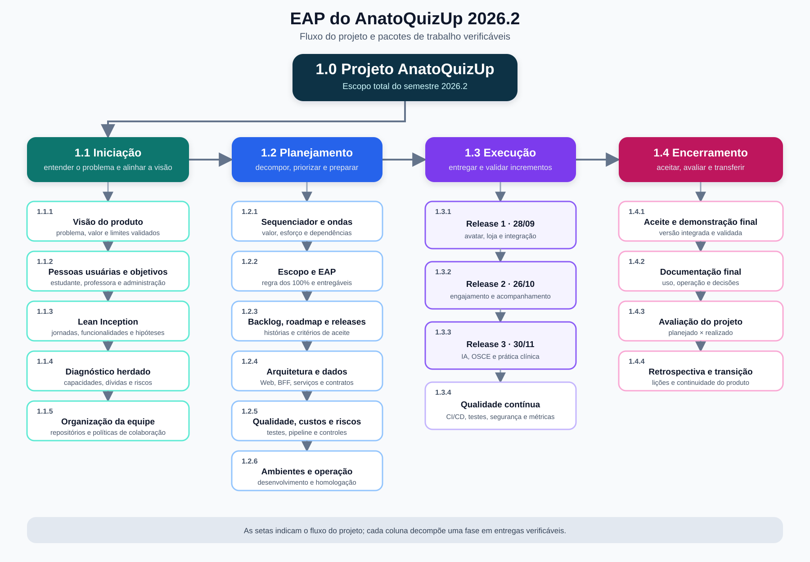
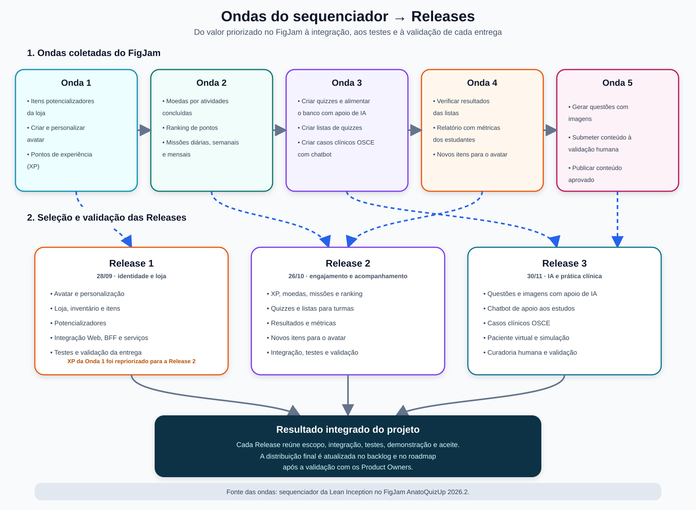

# Estrutura Analítica do Projeto (EAP) — AnatoQuizUp 2026.2

| Campo | Informação |
| --- | --- |
| Projeto | AnatoQuizUp — evolução 2026.2 |
| Versão | 2.0 |
| Data | 12/10/2026 |
| Responsável | Equipe AnatoQuizUp 2026.2 |
| Issue relacionada | [#67 — Refazer a EAP](https://github.com/fga-eps-mds/2026-2-AnatoQuizUp-Doc/issues/67) |

## 1. Objetivo do documento

Esta EAP organiza o **projeto inteiro** do AnatoQuizUp, da iniciação ao encerramento. Ela substitui a visão anterior, concentrada na Release 1, por uma estrutura que também abrange planejamento, qualidade, ondas do sequenciador, releases futuras, validação e documentação final.

A EAP descreve **entregáveis**, não atividades isoladas. Reuniões, commits, endpoints e pull requests são evidências ou meios de realização; os pacotes de trabalho representam os resultados que precisam existir e poder ser verificados.

## 2. Regras de construção adotadas

- **Regra dos 100%:** os filhos de cada pacote cobrem todo o trabalho do pai, sem incluir trabalho fora do escopo.
- **Orientação a entregáveis:** cada pacote gera um resultado verificável, como um plano, incremento de produto, ambiente, evidência de teste ou documento.
- **Exclusividade:** um resultado tem apenas um lugar na EAP, evitando dupla contagem.
- **Decomposição progressiva:** quando o escopo de uma release ainda não foi validado, ele aparece como pacote de planejamento e é detalhado após o refinamento com os Product Owners.

## 3. Artefatos visuais

### 3.1 Visão do projeto completo

{ loading=lazy }

### 3.2 Sequenciador, ondas e releases

O segundo diagrama apresenta as cinco ondas coletadas do sequenciador da Lean Inception e mostra como elas orientam a seleção de escopo das releases. Onda e release não são sinônimos: a onda expressa a ordem de valor e dependência das funcionalidades; a release representa o incremento efetivamente planejado, integrado e validado em uma data.

{ loading=lazy }

## 4. Visão geral

| Código | Fase | Resultado esperado |
| :---: | --- | --- |
| 1.1 | Iniciação | Direcionamento, entendimento do produto e base de trabalho compartilhada pela equipe. |
| 1.2 | Planejamento | Sequenciador, escopo, backlog, arquitetura, cronograma e estratégia de qualidade preparados para execução. |
| 1.3 | Execução | Incrementos do produto entregues em releases, com integração, testes e validação. |
| 1.4 | Encerramento | Aceite final, documentação consolidada, análise dos resultados e transição do conhecimento. |

## 5. Decomposição

### 1.1 Iniciação

**Objetivo da fase:** estabelecer o problema, as pessoas usuárias, a visão do produto e a forma de colaboração da equipe.

| Código | Pacote de trabalho | Entrega verificável |
| :---: | --- | --- |
| 1.1.1 | Visão do produto validada | Necessidades de estudantes e professoras, proposta de valor, limites e diferenciais documentados. |
| 1.1.2 | Pessoas usuárias e objetivos | Estudante, professora e administração identificados, com problemas, necessidades e resultados esperados. |
| 1.1.3 | Lean Inception | Visão, jornadas, funcionalidades, revisão técnica/de negócio/UX e hipóteses construídas em colaboração. |
| 1.1.4 | Diagnóstico do produto herdado | Capacidades existentes, dívidas técnicas, riscos e oportunidades de evolução conhecidos. |
| 1.1.5 | Organização da equipe | Repositórios, canais de comunicação, política de branches, commits e pull requests disponíveis. |

### 1.2 Planejamento

**Objetivo da fase:** transformar a visão em um plano executável e rastreável, mantendo clareza sobre o que já está definido e o que precisa de refinamento.

| Código | Pacote de trabalho | Entrega verificável |
| :---: | --- | --- |
| 1.2.1 | Sequenciador e ondas | Funcionalidades ordenadas em cinco ondas conforme valor, esforço, dependências e regras da Lean Inception. |
| 1.2.2 | Escopo e EAP | EAP aprovada, com pacotes de trabalho, limites e relação com o sequenciador e o backlog. |
| 1.2.3 | Backlog, roadmap e releases | Épicos, histórias, critérios de aceite e seleção das ondas para as Releases 1, 2 e 3. |
| 1.2.4 | Arquitetura e dados | Arquitetura Web, BFF e serviços, contratos, decisões técnicas e dados documentados. |
| 1.2.5 | Plano de qualidade, custos e riscos | Estratégia de testes, pipeline, critérios de pronto/feito, custos e riscos definidos. |
| 1.2.6 | Ambientes e operação | Instruções reproduzíveis para desenvolvimento, homologação e entrega do produto. |

#### 1.2.1.1 Ondas do sequenciador da Lean Inception

| Onda | Funcionalidades coletadas do FigJam |
| :---: | --- |
| 1 | Itens potencializadores da loja; criação e personalização do avatar; pontos de experiência (XP). |
| 2 | Moedas por atividades concluídas; ranking de pontos; missões diárias, semanais e mensais. |
| 3 | Criação de quizzes e alimentação do banco com apoio de IA; listas de quizzes; casos clínicos OSCE com chatbot. |
| 4 | Resultados das listas; relatório com métricas dos estudantes; novos itens para o avatar. |
| 5 | Geração de questões acompanhadas de imagens. |

### 1.3 Execução

**Objetivo da fase:** entregar incrementos verticais do AnatoQuizUp, demonstráveis às pessoas usuárias e integrados aos componentes necessários.

#### 1.3.1 Release 1 — identidade e loja (28/09)

| Código | Pacote de trabalho | Entrega verificável |
| :---: | --- | --- |
| 1.3.1.1 | Avatar e personalização | Avatar padrão, aparência e itens cosméticos disponíveis de forma consistente para a pessoa usuária autenticada. |
| 1.3.1.2 | Loja, inventário e potencializadores | Catálogo, compra, posse, uso de itens e efeitos dos potencializadores com regras de negócio validadas. |
| 1.3.1.3 | Integração da R1 | Fluxos Web, BFF e serviços integrados, testados e demonstráveis. |
| 1.3.1.4 | Validação da R1 | Critérios de aceite, revisão, evidências de testes e retorno das pessoas responsáveis registrados. |

#### 1.3.2 Release 2 — engajamento e acompanhamento (26/10)

| Código | Pacote de trabalho | Entrega verificável |
| :---: | --- | --- |
| 1.3.2.1 | Progressão e recompensas | XP, moedas e progressão tornam a evolução do estudante visível. |
| 1.3.2.2 | Missões e ranking | Missões diárias, semanais e mensais e ranking incentivam frequência e continuidade. |
| 1.3.2.3 | Quizzes e listas | Criação e resolução de quizzes e aplicação de listas às turmas. |
| 1.3.2.4 | Resultados e métricas | Resultados das listas e relatório de métricas apoiam estudante e professora. |
| 1.3.2.5 | Evolução do avatar | Novos itens de aparência ampliam a personalização e o uso das recompensas. |
| 1.3.2.6 | Validação da R2 | Incremento integrado, demonstrado e aceito segundo os critérios definidos no backlog. |

#### 1.3.3 Release 3 — inteligência artificial e prática clínica (30/11)

| Código | Pacote de trabalho | Entrega verificável |
| :---: | --- | --- |
| 1.3.3.1 | Questões e imagens com apoio de IA | Fluxo controlado para gerar questões acompanhadas de imagens e encaminhá-las à revisão humana. |
| 1.3.3.2 | Tutoria inteligente | Chatbot auxilia o estudo com esclarecimentos e explicações contextualizadas. |
| 1.3.3.3 | Casos clínicos OSCE | Casos reúnem tema, cenário, objetivos de aprendizagem, dados clínicos e critérios de avaliação. |
| 1.3.3.4 | Paciente virtual e simulação | Estudantes consultam o cenário, fazem perguntas e recebem respostas do paciente virtual. |
| 1.3.3.5 | Curadoria e consistência da IA | Professoras ou pessoas administradoras verificam o conteúdo antes da publicação e podem reportar inconsistências. |
| 1.3.3.6 | Validação da R3 | Incremento integrado, testado e avaliado com pessoas usuárias ou Product Owners. |

#### 1.3.4 Qualidade contínua das releases

| Código | Pacote de trabalho | Entrega verificável |
| :---: | --- | --- |
| 1.3.4.1 | Integração e entrega contínua | Pipelines executam lint, build, testes e análise estática nas alterações relevantes. |
| 1.3.4.2 | Testes e acessibilidade | Testes adequados aos fluxos entregues e critérios básicos de acessibilidade evidenciados. |
| 1.3.4.3 | Segurança e privacidade | Acesso, permissões e dados tratados de acordo com os riscos identificados. |
| 1.3.4.4 | Indicadores e melhoria | Métricas de produto, projeto e processo apoiam decisões e melhorias durante o semestre. |

### 1.4 Encerramento

**Objetivo da fase:** formalizar a qualidade, a aceitação e o conhecimento produzido, deixando o produto e sua documentação em condições de continuidade.

| Código | Pacote de trabalho | Entrega verificável |
| :---: | --- | --- |
| 1.4.1 | Aceite e demonstração final | Versão integrada apresentada, critérios de aceite verificados e retorno final registrado. |
| 1.4.2 | Documentação de encerramento | Guias de uso e operação, decisões, rastreabilidade e documentação técnica atualizados. |
| 1.4.3 | Avaliação do projeto | Comparação entre planejado e realizado em escopo, tempo, qualidade e riscos. |
| 1.4.4 | Retrospectiva e transição | Lições aprendidas, pendências e recomendações para a continuidade do AnatoQuizUp registradas. |

## 6. Pacotes de planejamento

As Releases 2 e 3 estão representadas de forma mais detalhada porque o FigJam e o [backlog](../backlog/visao-geral.md) já descrevem as necessidades a refinar. As cinco ondas orientam a ordem de valor e dependência, mas não formam uma correspondência automática com as três releases. O compromisso de implementação, a distribuição entre releases e os critérios completos de aceite dependem de validação com os Product Owners e da capacidade do time.

| Pacote | Depende de | Critério para detalhamento final |
| --- | --- | --- |
| 1.3.2 Release 2 | Retorno da R1, Ondas 2 e 4 e priorização do backlog | Escopo da release e histórias priorizadas validados. |
| 1.3.3 Release 3 | Ondas 3 e 5, retorno da R2, viabilidade técnica e validação pedagógica | Casos de uso de IA e simulação aprovados, com limites e responsáveis pela curadoria definidos. |

## 7. Rastreabilidade

O código da EAP liga o planejamento às entregas operacionais, sem duplicar detalhes que pertencem ao GitHub e ao backlog:

```text
Fase da EAP       → épico ou objetivo de planejamento
Pacote da EAP     → issue ou história de usuário
Decomposição      → sub-issues, tarefas técnicas e pull requests
Pacote concluído  → teste, demonstração e aceite registrados
```

Uma issue sem relação com um pacote desta EAP deve ser avaliada como possível mudança de escopo. Quando necessário, a EAP e o roadmap devem ser atualizados antes de assumir o trabalho como parte do projeto.

## 8. Política de atualização

Este documento será atualizado quando houver inclusão, exclusão ou reorganização estrutural de pacotes, mudança de escopo de uma release ou decomposição de um pacote ainda em planejamento. Trocas de responsável, atualização de status e tarefas diárias devem permanecer no GitHub ou no backlog.

## 9. Referências

- PMI. *A Guide to the Project Management Body of Knowledge (PMBOK Guide)* — decomposição de escopo, regra dos 100% e planejamento em ondas sucessivas.
- NORMAN, E. S.; BROTHERTON, S. A.; FRIED, R. T. *Work Breakdown Structures: The Foundation for Project Management Excellence*. John Wiley, 2011.
- CAROLI, P. *Lean Inception: como alinhar pessoas e construir o produto certo* — origem do sequenciador que define as ondas.
- [EAP 2026.1](https://github.com/fga-eps-mds/2026.1-MeasureSoftGram-DOC/blob/main/docs/produto/eap.md) — versão do semestre anterior, mantida como registro da evolução do documento.
- [FigJam da Visão do Produto AnatoQuizUp 2026.2](https://www.figma.com/board/IwsqM1gCmdrS2ZrR8HgRGz/Vis%C3%A3o-do-Produto-AnatoQuizUP-2026-2?node-id=17142-1766) — fonte das funcionalidades e ondas do sequenciador.
- [Visão do Produto](visao.md) e [Backlog do Produto](../backlog/visao-geral.md) — fontes do escopo funcional e das prioridades do AnatoQuizUp.

## 10. Histórico de versão

| Versão | Data | Descrição | Responsável |
| --- | --- | --- | --- |
| 1.0 | 27/09/2026 | Estrutura inicial com foco predominante na R1. | Equipe AnatoQuizUp 2026.2 |
| 2.0 | 12/10/2026 | EAP refeita para cobrir o ciclo completo do projeto, com releases, pacotes de planejamento e diagramas visuais. | Letícia Torres Soares Martins |
