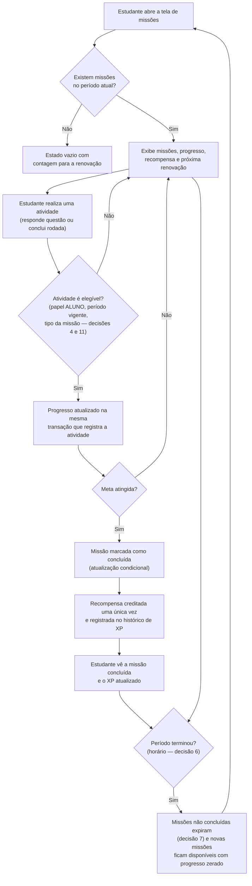

# Missões Diárias

| Campo | Informação |
| --- | --- |
| Situação | **Proposta em validação**: nenhuma regra deste documento foi aprovada pelo PO até a versão 1.0 |
| Épico | [#62 — Progressão, missões e ranking por XP](https://github.com/fga-eps-mds/2026-2-AnatoQuizUp-Doc/issues/62) |
| Definição e protótipo | [#83 — Definir e prototipar missões diárias](https://github.com/fga-eps-mds/2026-2-AnatoQuizUp-Doc/issues/83) |
| Implementação | [#84 — Implementar missões diárias, progresso e recompensas](https://github.com/fga-eps-mds/2026-2-AnatoQuizUp-Doc/issues/84) |
| Protótipo | [Figma — Missões diárias](https://www.figma.com/design/qKgur6yKTkAN83ofJtbFxM/AnatoQuizUp-2026.2?node-id=96-221) |
| Release | Release 2, conforme o [Roadmap](roadmap.md) |

## 1. Objetivo e escopo

As missões diárias são pequenas metas de estudo que renovam a cada dia. Elas incentivam o estudante a voltar à plataforma e a praticar com regularidade. Ao concluir uma missão, o estudante recebe uma recompensa que alimenta a progressão gamificada (XP, nível e ranking).

O [Roadmap](roadmap.md) inclui as missões no escopo de gamificação da Release 2 ("missões associadas a comportamentos de aprendizagem"). Um dos critérios de saída dessa release é que "XP, moedas e missões são gerados por ações educacionais verificáveis". Por isso, toda missão deve medir uma ação de estudo registrada pelo sistema, e não um simples acesso à plataforma.

### 1.1 O que entra no MVP

- Apenas missões **diárias**.
- Visualização das missões do dia, do progresso e da recompensa.
- Atualização do progresso a partir de atividades válidas.
- Conclusão da missão e crédito da recompensa uma única vez.
- Renovação diária.

### 1.2 Fora do escopo

- Missões semanais, até validação com o PO. O modelo proposto na seção 5 permite incluí-las depois.
- Ofensiva diária (streak) e congelamento de sequência, que devem ter issue própria.
- Elos ou ligas de progressão.
- Gestão de missões por professores ou administradores.

### 1.3 Como ler este documento

Cada informação aparece com uma das marcações abaixo, para não confundir proposta com regra aprovada.

| Marcação | Significado |
| --- | --- |
| **Implementado** | Comportamento verificado no código da branch `main` do serviço. |
| **Implementado em PR aberto** | Comportamento presente em um Pull Request ainda não integrado à `main`. |
| **Proposta** | Sugestão do protótipo ou da equipe, que ainda depende de aprovação. |
| **Pendente** | Decisão em aberto, sem proposta definida. |
| **Aprovado** | Decisão confirmada pelo PO. Nenhum item tem esta marcação na versão 1.0. |

## 2. Base existente no sistema

Esta seção resume o que o código já oferece e o que as missões podem reaproveitar. Os dados foram consultados em 13/10/2026.

| Recurso | Situação | Evidência |
| --- | --- | --- |
| Moedas por acerto no quiz livre: 10 (fácil), 25 (média) ou 50 (difícil), somente no primeiro acerto de cada questão e somente para o papel ALUNO | Implementado | `quiz.service.ts` (`MOEDAS_POR_DIFICULDADE`) no Quiz-Service |
| Conquistas processadas a cada resposta do quiz livre (tipos `STREAK_ACERTOS`, `TOTAL_ACERTOS`, `TOTAL_ACERTOS_TEMA` e `PERCENTUAL_ACERTO_TEMA`) | Implementado | `conquistas.service.ts` e `schema.prisma` no Quiz-Service |
| Respostas de listas de turma não geram moedas, conquistas nem XP | Implementado | Módulo `resolucaoLista` do Quiz-Service |
| Rodadas finitas de quiz, com até 10 questões, e botão "Concluir quiz" | Implementado em PR aberto | [Quiz-Service #10](https://github.com/fga-eps-mds/2026-2-AnatoQuizUp-Quiz-Service/pull/10) e [Web #12](https://github.com/fga-eps-mds/2026-2-AnatoQuizUp-Web/pull/12) |
| XP ao concluir a rodada: 5 XP por questão, mais bônus por acerto de 5 (fácil), 10 (média) ou 15 (difícil) | Implementado em PR aberto | `progressao.constants.ts` no [Quiz-Service #10](https://github.com/fga-eps-mds/2026-2-AnatoQuizUp-Quiz-Service/pull/10) |
| Nível calculado pelo XP acumulado: sair do nível N custa 100 × N XP | Implementado em PR aberto | `progressao.constants.ts` no [Quiz-Service #10](https://github.com/fga-eps-mds/2026-2-AnatoQuizUp-Quiz-Service/pull/10) |
| Proteção contra XP duplicado na conclusão da rodada | Implementado em PR aberto | Atualização condicional da rodada dentro de uma transação e `tentativaId` único em `TransacaoXp` ([Quiz-Service #10](https://github.com/fga-eps-mds/2026-2-AnatoQuizUp-Quiz-Service/pull/10)) |
| Histórico de XP, com origem `QUIZ_CONCLUIDO` | Implementado em PR aberto | Enum `OrigemXp` e rota `GET /quiz/xp/historico` ([Quiz-Service #10](https://github.com/fga-eps-mds/2026-2-AnatoQuizUp-Quiz-Service/pull/10)) |
| Ranking geral e de amigos ordenados por XP | Implementado em PR aberto | [BFF #4](https://github.com/fga-eps-mds/2026-2-AnatoQuizUp-BFF/pull/4) |

!!! warning "Dependência da issue #63"
    Os PRs da [#63](https://github.com/fga-eps-mds/2026-2-AnatoQuizUp-Doc/issues/63) (Quiz-Service #10, BFF #4 e Web #12) **não estavam integrados à `main`** em 13/10/2026. As regras abaixo que dependem de XP, de rodadas finitas ou de "concluir quiz" só podem ser implementadas depois desse merge.

Detalhes relevantes da implementação de rodadas no [Quiz-Service #10](https://github.com/fga-eps-mds/2026-2-AnatoQuizUp-Quiz-Service/pull/10):

- A rodada é iniciada por `POST /quiz/tentativas`, com tema e dificuldade opcionais. O tema é gravado pelo **nome**.
- A rodada só pode ser concluída depois que todas as questões forem respondidas. Antes disso, `POST /quiz/tentativas/:id/concluir` retorna 409.
- Concluir a mesma rodada de novo devolve o mesmo resultado com `jaConcluida = true` e não credita XP outra vez.
- Somente o papel ALUNO recebe XP.
- Respostas fora de uma rodada continuam permitidas: o campo `tentativaId` da resposta é opcional.

## 3. Catálogo e tipos de missão

### 3.1 Missões sugeridas pelo protótipo

O protótipo apresenta **3 missões por dia**, todas com recompensa em XP. Esses valores são **proposta** e dependem da confirmação do PO (seção 6).

| Nome no protótipo | Descrição no protótipo | Meta | Recompensa | Situação |
| --- | --- | --- | --- | --- |
| Aquecimento diário | Responda 5 questões em qualquer quiz. | 5 questões respondidas | 30 XP | Proposta |
| Precisão anatômica | Acerte 8 questões durante os quizzes. | 8 acertos | 50 XP | Proposta |
| Ritmo de estudo | Conclua 3 quizzes diferentes hoje. | 3 quizzes concluídos | 70 XP | Proposta |

Somando as três, o estudante pode ganhar 150 XP por dia com missões.

### 3.2 Tipos de missão

Cada missão do protótipo corresponde a um **tipo**, ou seja, à ação que faz o progresso aumentar. A tabela abaixo descreve como cada tipo pode ser medido com os dados que o sistema já registra. Os pontos marcados como pendentes não devem ser decididos pela implementação.

| Tipo proposto | Ação medida | Fonte do evento | Pontos pendentes |
| --- | --- | --- | --- |
| `RESPONDER_QUESTOES` | Cada resposta registrada no quiz | `POST /quiz/responder` (implementado) | Se respostas fora de uma rodada contam; se responder de novo a mesma questão no mesmo dia conta; se respostas de listas de turma contam |
| `ACERTAR_QUESTOES` | Cada resposta correta registrada no quiz | `POST /quiz/responder` (implementado) | Os mesmos pontos do tipo anterior; se acertar de novo uma questão já acertada conta (hoje, as moedas só são pagas no primeiro acerto) |
| `CONCLUIR_QUIZZES` | Cada rodada concluída pela primeira vez | `POST /quiz/tentativas/:id/concluir` (PR aberto) | O que significa "quizzes diferentes" (seção 3.3) |

Regras de medição propostas, comuns a todos os tipos:

- Só contam atividades feitas pelo papel ALUNO, como já acontece com moedas, conquistas e XP.
- Só contam atividades registradas dentro do período da missão (seção 5).
- O progresso não ultrapassa a meta. Atividades extras depois da conclusão não alteram a missão.
- Repetir uma requisição que o sistema já ignora não aumenta o progresso. Exemplo: uma rodada que retorna `jaConcluida = true` não conta de novo para `CONCLUIR_QUIZZES`.

### 3.3 "Concluir 3 quizzes diferentes"

Esta missão depende da definição de "concluir um quiz". O [Quiz-Service #10](https://github.com/fga-eps-mds/2026-2-AnatoQuizUp-Quiz-Service/pull/10) define isso: uma rodada concluída com todas as questões respondidas. Essa definição só pode ser adotada depois do merge do PR.

O protótipo diz "quizzes **diferentes**", mas nenhum documento define o que torna dois quizzes diferentes. As possibilidades são:

| Opção | Como contaria | Consequência |
| --- | --- | --- |
| A. Qualquer rodada concluída | Cada rodada nova conta, mesmo com o mesmo tema e a mesma dificuldade | Simples de implementar; o texto da missão deveria deixar de dizer "diferentes" |
| B. Combinação diferente de tema e dificuldade | Duas rodadas com o mesmo tema e a mesma dificuldade contam uma vez | Incentiva variar o conteúdo; a rodada já grava tema e dificuldade |
| C. Tema diferente | Só conta rodada de um tema ainda não concluído no dia | Incentiva mais variedade; pode ser difícil de cumprir em temas com poucas questões |

**Situação:** pendente. Nenhuma das opções deve ser assumida sem decisão do PO.

### 3.4 Missões iguais para todos ou individualizadas

O protótipo não mostra se todos os estudantes recebem as mesmas missões. Selecionar missões por estudante (sorteio ou personalização) exige mais regras e não aparece em nenhum documento. **Situação:** pendente.

## 4. Recompensas

### 4.1 Valores

O protótipo sugere recompensas apenas em XP: 30, 50 e 70 XP. **Situação:** proposta. Ainda não está decidido se as missões também dão moedas ou itens.

Para comparação, uma rodada de 10 questões de dificuldade média com 10 acertos rende 150 XP pela regra do [Quiz-Service #10](https://github.com/fga-eps-mds/2026-2-AnatoQuizUp-Quiz-Service/pull/10): 50 XP de base mais 100 XP de bônus. O balanceamento entre XP de quiz e XP de missões deve ser avaliado na validação.

### 4.2 Integração com o mecanismo de XP

Se a recompensa for XP, a proposta é reaproveitar o mecanismo da [#63](https://github.com/fga-eps-mds/2026-2-AnatoQuizUp-Doc/issues/63), sem criar um saldo paralelo:

1. Somar o valor ao `xpTotal` de `ProgressoXp`. Assim, nível e ranking passam a considerar a recompensa automaticamente.
2. Registrar uma linha em `TransacaoXp` com uma nova origem, por exemplo `MISSAO_CONCLUIDA`. Hoje o enum `OrigemXp` só tem `QUIZ_CONCLUIDO`.
3. Associar a transação à missão do período, por exemplo por um campo único que referencie a missão do estudante, no mesmo padrão do `tentativaId` único usado nas rodadas.

O histórico de XP já exibe data, origem e valor, o que atende ao critério da [#84](https://github.com/fga-eps-mds/2026-2-AnatoQuizUp-Doc/issues/84) de registrar a recompensa com a origem "missão".

Se a recompensa incluir moedas, será preciso criar uma origem própria em `FonteMoeda`, que hoje tem `ACERTO_QUESTAO`, `DESBLOQUEIO_CONQUISTA`, `COMPRA_ITEM` e `USO_POTENCIALIZADOR`.

### 4.3 Proteção contra crédito duplicado

Proposta técnica, baseada no padrão já adotado no [Quiz-Service #10](https://github.com/fga-eps-mds/2026-2-AnatoQuizUp-Quiz-Service/pull/10):

- Marcar a missão como concluída com uma **atualização condicional**: atualizar somente se o status ainda estiver "em andamento". Se nenhuma linha for alterada, outra requisição já concluiu a missão, e nada é creditado.
- Fazer a conclusão da missão e o crédito da recompensa na **mesma transação** de banco.
- Ter uma **restrição única** que impeça duas transações de XP para a mesma missão do mesmo período.
- Atualizar o progresso dentro da mesma transação que registra a atividade, como já acontece com moedas e conquistas (decisão arquitetural [DA-06](../arquitetura/decisoes.md)).

## 5. Renovação e periodicidade

### 5.1 Proposta de renovação

| Item | Proposta | Situação |
| --- | --- | --- |
| Horário | 00:00 | Proposta |
| Fuso horário | `America/Sao_Paulo` (horário de Brasília) | Proposta |
| Missão não concluída até a renovação | Expira sem recompensa; a missão do novo dia começa com progresso zerado | Proposta |
| Atividade feita antes da renovação | Não conta para as missões do novo dia | Proposta (já está nos critérios da [#84](https://github.com/fga-eps-mds/2026-2-AnatoQuizUp-Doc/issues/84)) |

O backend não usa nenhum fuso horário hoje: as datas são gravadas pelo banco com `now()`. O dashboard do projeto já exibe horários no horário de Brasília. Recomenda-se configurar o fuso pelo identificador IANA (`America/Sao_Paulo`), e não por um deslocamento fixo de −3 horas, para que uma eventual mudança nas regras de horário de verão não exija alteração de código.

### 5.2 Modelo proposto, preparado para missões semanais

Proposta técnica para a implementação na [#84](https://github.com/fga-eps-mds/2026-2-AnatoQuizUp-Doc/issues/84), mantida simples para o MVP:

- **Catálogo de missões:** código, nome, descrição, tipo, meta, recompensa, **periodicidade** (no MVP, só `DIARIA`) e indicador de ativa.
- **Missão do estudante no período:** estudante, missão, **início e fim do período**, progresso, status e data de conclusão.
- **Restrição única** em estudante + missão + início do período. Ela identifica a qual período cada registro pertence e impede duplicatas.

Regras do período:

- O início e o fim são calculados no fuso configurado e gravados em UTC. Exemplo de período diário: de 00:00 de um dia até 00:00 do dia seguinte, no horário de Brasília.
- Uma atividade conta para o período em que foi registrada pelo servidor, e não pelo relógio do navegador.
- Para incluir missões semanais, basta uma nova periodicidade (`SEMANAL`) e o cálculo de início e fim correspondente. Tipos, progresso e recompensa continuam iguais.

Como criar as missões do dia sem tarefa agendada: os registros do período podem ser criados **quando necessário**, isto é, na primeira vez que o estudante abre a tela de missões ou realiza uma atividade no período. Isso evita depender de um processo agendado à meia-noite.

Status propostos para a missão do estudante:

| Status | Quando |
| --- | --- |
| `EM_ANDAMENTO` | Período vigente e meta não atingida |
| `CONCLUIDA` | Meta atingida e recompensa creditada |
| `EXPIRADA` | Período encerrado sem atingir a meta. Pode ser calculado pela data, sem tarefa agendada |

O protótipo também mostra um card com o estado **"Em breve"**, que não está previsto na [#83](https://github.com/fga-eps-mds/2026-2-AnatoQuizUp-Doc/issues/83). **Situação:** pendente. É preciso decidir se ele existe e o que significa.

### 5.3 Falhas e requisições repetidas

- Se o registro da atividade falhar, o progresso não é alterado, porque ambos ficam na mesma transação.
- Se a tela de missões falhar ao carregar, a atividade já registrada continua valendo, e o progresso aparece no próximo carregamento.
- Repetir a conclusão de uma rodada ou de uma missão não credita nada novo (seção 4.3).

O protótipo do estado de erro diz que "as respostas concluídas continuam registradas e serão contabilizadas após a sincronização". Isso só é verdade quando a falha é apenas na consulta das missões. Se o Quiz-Service estiver fora do ar, as respostas também não são registradas. Recomenda-se revisar esse texto.

## 6. Decisões pendentes para o PO

Nenhuma decisão abaixo está confirmada. O responsável pela aprovação é o PO do projeto, que não está identificado nominalmente nas issues consultadas.

| # | Questão | Proposta existente | Situação | Impacto |
| ---: | --- | --- | --- | --- |
| 1 | Quais tipos de missão existem na primeira versão? | Responder questões, acertar questões e concluir quizzes (protótipo) | Pendente | Define os eventos que a implementação precisa observar |
| 2 | Quantas missões o estudante recebe por dia? | 3 (protótipo) | Pendente | Layout da tela e balanceamento de XP |
| 3 | As missões são iguais para todos ou individualizadas? | Sem proposta | Pendente | Missões individualizadas exigem regras de sorteio ou personalização |
| 4 | Quais atividades contam para o progresso? Respostas de listas de turma contam? Respostas fora de uma rodada contam? Repetir uma questão conta? | Sem proposta. Hoje, listas não geram nenhuma recompensa | Pendente | Contar listas exige integrar a submissão de listas às missões |
| 5 | Qual é o tipo e o valor das recompensas? | XP: 30, 50 e 70 (protótipo) | Pendente | Moedas ou itens exigem novas origens de transação |
| 6 | Em que horário e fuso as missões renovam? | 00:00, horário de Brasília (`America/Sao_Paulo`) | Pendente | Cálculo do período e texto da contagem regressiva |
| 7 | O que acontece com missões não concluídas? | Expiram sem recompensa, e o progresso do novo dia começa zerado | Pendente | Status `EXPIRADA` e mensagens da interface |
| 8 | Como as missões se relacionam com as conquistas? | Sem proposta | Pendente | "Acertar 8 questões" e as conquistas de total de acertos premiam a mesma ação. É preciso decidir se isso é aceitável |
| 9 | O estudante pode ver o histórico de missões de dias anteriores? | Sem proposta | Pendente | Se sim, é preciso uma tela ou seção a mais; os dados já ficariam guardados pelo modelo da seção 5.2 |
| 10 | Como o catálogo é criado e mantido? | Sem proposta. Para o MVP, um catálogo fixo carregado por seed é o caminho mais simples | Pendente | Configuração por administrador exigiria uma história adicional |
| 11 | O que significa "quizzes diferentes"? | Opções A, B e C da seção 3.3 | Pendente | Regra de contagem do tipo `CONCLUIR_QUIZZES` |
| 12 | O estado "Em breve" do card existe? | Aparece no protótipo, sem definição | Pendente | Status adicional e regra de liberação |

## 7. Fluxo do estudante

O fluxo abaixo é **proposto**. Nenhuma etapa de missões existe no código. As etapas de responder questões e concluir rodada já existem: a primeira na `main` e a segunda no PR aberto da [#63](https://github.com/fga-eps-mds/2026-2-AnatoQuizUp-Doc/issues/63).



Pontos do fluxo que dependem do PO: elegibilidade das atividades (decisões 4 e 11), recompensa (decisão 5), horário de renovação (decisão 6) e comportamento das missões expiradas (decisão 7).

## 8. Contrato entre Quiz-Service, BFF e Web

!!! note "Contrato proposto"
    Nada nesta seção está implementado. As rotas, os campos e o formato da resposta são **propostas** e precisam ser validados pela equipe antes da [#84](https://github.com/fga-eps-mds/2026-2-AnatoQuizUp-Doc/issues/84).

### 8.1 Responsabilidades

| Componente | Responsabilidade proposta | Justificativa |
| --- | --- | --- |
| Quiz-Service | Fonte de verdade das missões: catálogo, períodos, progresso, conclusão e crédito da recompensa | A [DA-06](../arquitetura/decisoes.md) mantém a gamificação no Quiz-Service, porque a recompensa acontece na mesma transação da atividade. O XP também fica nesse serviço |
| BFF | Validar o JWT, repassar a identidade do usuário (`x-user-id` e `x-user-papel`) e encaminhar a requisição ao Quiz-Service | É o padrão do proxy atual (`criarProxyHandler`). A identidade nunca vem do corpo da requisição |
| Web | Exibir as missões, o progresso, a contagem regressiva e os estados de carregamento, vazio e erro | Conforme o protótipo |
| Usuario-Service | Nenhuma | As missões não dependem de dados de cadastro |

### 8.2 Rota proposta

| Item | Proposta |
| --- | --- |
| Método | `GET` |
| Rota pública no BFF | `/api/v1/missoes/minhas` |
| Rota no Quiz-Service | `/api/v1/missoes/minhas` |
| Autenticação | JWT obrigatório; apenas as missões do usuário autenticado |
| Efeito colateral | Pode criar os registros do período atual, se ainda não existirem (seção 5.2) |

O nome segue a convenção das rotas existentes para dados do próprio usuário, como `/conquistas/minhas`, `/conquistas/meu-progresso` e `/loja/meu-historico`. O prefixo próprio `/missoes` exige uma linha de proxy no BFF, igual à de `/conquistas`.

Há uma alternativa: montar a rota dentro de `/quiz` (`/api/v1/quiz/missoes`), como o [Quiz-Service #10](https://github.com/fga-eps-mds/2026-2-AnatoQuizUp-Quiz-Service/pull/10) fez com a progressão. Nesse caso, o BFF não precisa de alteração. A escolha entre as duas opções fica para a equipe.

Não há rota para "concluir missão". A conclusão acontece no Quiz-Service quando uma atividade faz o progresso atingir a meta.

### 8.3 Campos da resposta

Nenhum dos campos abaixo existe hoje. Todos precisam ser implementados.

| Campo | Tipo sugerido | Finalidade |
| --- | --- | --- |
| `periodo.inicio` | string (ISO 8601, UTC) | Início do período das missões listadas |
| `periodo.fim` | string (ISO 8601, UTC) | Fim do período; também é o horário da próxima renovação |
| `periodo.fusoHorario` | string (IANA) | Fuso usado no cálculo, para exibição |
| `missoes[].id` | string | Identificador da missão do estudante no período |
| `missoes[].codigo` | string | Identificador estável da missão no catálogo |
| `missoes[].nome` | string | Título exibido no card |
| `missoes[].descricao` | string | Texto de apoio do card |
| `missoes[].tipo` | string (enum) | `RESPONDER_QUESTOES`, `ACERTAR_QUESTOES` ou `CONCLUIR_QUIZZES` |
| `missoes[].meta` | number | Quantidade necessária para concluir |
| `missoes[].progresso` | number | Quantidade atual, limitada à meta |
| `missoes[].recompensaXp` | number | XP creditado na conclusão |
| `missoes[].status` | string (enum) | `EM_ANDAMENTO`, `CONCLUIDA` ou `EXPIRADA` |
| `missoes[].concluidaEm` | string (ISO 8601) ou null | Momento da conclusão |
| `resumo.concluidas` | number | Missões concluídas no período |
| `resumo.total` | number | Total de missões do período |
| `resumo.xpGanhoHoje` | number | XP recebido pelas missões no período, exibido como "ganhos hoje" |

O percentual exibido na tela pode ser calculado pela Web a partir de `progresso` e `meta`.

### 8.4 Exemplo de resposta (ilustrativo)

```json
{
  "periodo": {
    "inicio": "2026-10-13T03:00:00.000Z",
    "fim": "2026-10-14T03:00:00.000Z",
    "fusoHorario": "America/Sao_Paulo"
  },
  "missoes": [
    {
      "id": "cm_exemplo_1",
      "codigo": "AQUECIMENTO_DIARIO",
      "nome": "Aquecimento diário",
      "descricao": "Responda 5 questões em qualquer quiz.",
      "tipo": "RESPONDER_QUESTOES",
      "meta": 5,
      "progresso": 5,
      "recompensaXp": 30,
      "status": "CONCLUIDA",
      "concluidaEm": "2026-10-13T14:12:08.000Z"
    },
    {
      "id": "cm_exemplo_2",
      "codigo": "PRECISAO_ANATOMICA",
      "nome": "Precisão anatômica",
      "descricao": "Acerte 8 questões durante os quizzes.",
      "tipo": "ACERTAR_QUESTOES",
      "meta": 8,
      "progresso": 6,
      "recompensaXp": 50,
      "status": "EM_ANDAMENTO",
      "concluidaEm": null
    }
  ],
  "resumo": {
    "concluidas": 1,
    "total": 2,
    "xpGanhoHoje": 30
  }
}
```

O exemplo usa os valores do protótipo apenas como ilustração e mostra duas missões para ficar curto.

### 8.5 Aviso de conclusão ao estudante

O protótipo mostra o aviso "Missão concluída! +50 XP adicionados". Para isso, a Web precisa saber que uma missão foi concluída. Há duas formas possíveis:

- Incluir as missões concluídas na resposta de `POST /quiz/responder` e de `POST /quiz/tentativas/:id/concluir`, como já é feito com `conquistasDesbloqueadas`.
- Detectar a mudança de status na próxima consulta a `GET /missoes/minhas`.

A primeira opção dá retorno imediato e segue o padrão das conquistas. **Situação:** pendente de decisão técnica.

### 8.6 Estados que a Web deve tratar

| Estado | Condição proposta | Tela do protótipo |
| --- | --- | --- |
| Carregando | Requisição em andamento | "Carregando" |
| Sem missões | Resposta 200 com `missoes` vazia | "Nenhuma missão disponível agora" |
| Em andamento | Pelo menos uma missão `EM_ANDAMENTO` | "Missões em andamento" |
| Todas concluídas | `resumo.concluidas` igual a `resumo.total` | "Você completou as missões de hoje!" |
| Missão concluída | Missão nova com status `CONCLUIDA` (seção 8.5) | "Missão concluída!" |
| Erro | Falha de rede ou resposta 4xx/5xx | "Não conseguimos carregar suas missões" |

O código de suporte "MIS-503" do protótipo não existe no sistema. Os códigos de erro atuais seguem o enum `CodigoDeErro` dos serviços. **Situação:** pendente.

## 9. Rastreabilidade dos critérios da #83

| Critério de aceitação da #83 | Onde está | Documentado | Implementado | Validado pelo PO |
| --- | --- | --- | --- | --- |
| Os tipos de missão da primeira versão estão listados com exemplos e critérios mensuráveis | Seções 3.1 e 3.2 | Sim, como proposta | Não | Não |
| O horário de renovação e o fuso estão definidos explicitamente | Seção 5.1 | Sim, como proposta | Não | Não |
| As recompensas e as regras para evitar crédito duplicado estão documentadas | Seções 4.1 a 4.3 | Sim; valores como proposta | Não. O padrão de idempotência existe no PR aberto da #63 | Não |
| O protótipo apresenta a listagem, o progresso, a conclusão e o recebimento da recompensa | [Figma](https://www.figma.com/design/qKgur6yKTkAN83ofJtbFxM/AnatoQuizUp-2026.2?node-id=96-221) e [#84](https://github.com/fga-eps-mds/2026-2-AnatoQuizUp-Doc/issues/84) | Sim | Não se aplica | Não |
| O protótipo contempla os estados vazio, em andamento e concluído | [Figma](https://www.figma.com/design/qKgur6yKTkAN83ofJtbFxM/AnatoQuizUp-2026.2?node-id=96-221) e seção 8.6 | Sim | Não se aplica | Não |
| Está definido quais atividades aumentam o progresso de cada missão | Seção 3.2 e decisões 4 e 11 | Parcial: os eventos estão mapeados, mas a elegibilidade depende do PO | Não | Não |
| A documentação permite incluir missões semanais futuramente sem alterar o conceito principal | Seção 5.2 | Sim, como proposta técnica | Não | Não |
| A #84 referencia a documentação aprovada como pré-requisito de implementação | — | Não; depende da aprovação | Não se aplica | Não |

## 10. Referências

- [Roadmap](roadmap.md) — escopo de gamificação da Release 2.
- [Backlog do Produto](../backlog/visao-geral.md).
- [Decisões Arquiteturais — DA-06](../arquitetura/decisoes.md).
- [Endpoints](../arquitetura/endpoints.md).
- [Issue #63 — Receber XP e evoluir de nível](https://github.com/fga-eps-mds/2026-2-AnatoQuizUp-Doc/issues/63) e PRs [Quiz-Service #10](https://github.com/fga-eps-mds/2026-2-AnatoQuizUp-Quiz-Service/pull/10), [BFF #4](https://github.com/fga-eps-mds/2026-2-AnatoQuizUp-BFF/pull/4) e [Web #12](https://github.com/fga-eps-mds/2026-2-AnatoQuizUp-Web/pull/12), consultados em 13/10/2026.
- [Protótipo no Figma — Missões diárias](https://www.figma.com/design/qKgur6yKTkAN83ofJtbFxM/AnatoQuizUp-2026.2?node-id=96-221).

## Histórico de Versão

| Data | Versão | Descrição | Autor(es) |
| :--- | :--- | :--- | :--- |
| 13/10/2026 | 1.0 | Criação da proposta de regras, fluxo e contrato das missões diárias para validação pelo PO (issue #83) | [Rafael Melo](https://github.com/rmatuda) |
