# Resultados dos testes

## Apresentação

Este relatório reúne os resultados da execução manual do [roteiro de testes de sistema](roteiro-testes.md), realizada por [Brenno Oliveira](https://github.com/Brenno-Silva01) entre **21 e 23 de outubro de 2026**, no ambiente de homologação do AnatoQuizUp.

Foram registrados **13 casos: 9 aprovados, 2 com falha e 2 bloqueados**. O registro preserva os limites de cada verificação; não representa aprovação integral do sistema ou aceite formal do produto.

## Ambiente avaliado

| Informação | Registro |
|---|---|
| Ambiente | [Homologação](https://anatoquizup-homolog-2026-2.netlify.app) |
| Período | 21 a 23/10/2026 |
| Navegador e sistema | Firefox em Windows, conforme capturas; versão do navegador e resolução não informadas |
| Horários | Horários visíveis nas capturas; fuso do executor: America/Sao_Paulo |
| Frontend observado | `/assets/index-DwxRb5sh.js`, confirmado em consulta pública de 23/10/2026 às 16:10 |
| CSS observado | `/assets/index-CsBMaz9i.css` |
| Endereço do BFF utilizado pelo frontend | `https://minio-homolog.up.railway.app/api/v1` |
| Commits publicados | Não identificados para Web, BFF, Quiz-Service e Usuario-Service |

Os resultados correspondem ao **deploy observado durante a execução**, sem equivalência comprovada com a versão mais recente da `main`. As imagens identificam os estados das telas. As sequências confirmadas apenas por relato estão indicadas abaixo.

## Resultados por funcionalidade

### Autenticação e controle de acesso

| Caso | Resultado | Comportamento observado | Evidências |
|---|---|---|---|
| CT-AU-01 | Falhou | A conta de aluno acessou a aplicação, mas abrir ou recarregar `/aluno/perfil` apresentou 404 do Netlify. A invalidação da sessão não foi comprovada nesse caso. | [1_1.PNG](../assets/images/roteiro-testes/rodada-2026-10/1_1.PNG), [2.PNG](../assets/images/roteiro-testes/rodada-2026-10/2.PNG); recarregamento também relatado durante sessão autenticada |
| CT-AC-01 | Aprovado | A conta nova apresentou seu próprio estado inicial. Após personalizá-la, João manteve seu avatar azul, com cabelo castanho e óculos. | [12_2.PNG](../assets/images/roteiro-testes/rodada-2026-10/12_2.PNG), [12_3.PNG](../assets/images/roteiro-testes/rodada-2026-10/12_3.PNG); alteração de B e retorno a A confirmados por relato, sem captura dessa sequência |
| CT-AC-02 | Bloqueado | Professor não dispõe da opção de edição de avatar no menu. O acesso direto à página resultou em 404 da hospedagem, impedindo avaliar a autorização pela aplicação. | Relato e transcrição da página 404; sem captura adicional |

### Avatar e personalização

| Caso | Resultado | Comportamento observado | Evidências |
|---|---|---|---|
| CT-AV-01 | Aprovado | A conta nova exibiu cérebro rosa, sem cabelo ou acessório, com luvas e calçados azuis. O padrão permaneceu após novo login. | [12_3.PNG](../assets/images/roteiro-testes/rodada-2026-10/12_3.PNG); primeiro acesso e permanência confirmados por relato |
| CT-AV-02 | Aprovado | Aparência e Acessórios exibiram opções e atualizaram a prévia antes de salvar. Cérebro azul, cabelo castanho e óculos permaneceram após novo login. | [12.PNG](../assets/images/roteiro-testes/rodada-2026-10/12.PNG), [12_1.PNG](../assets/images/roteiro-testes/rodada-2026-10/12_1.PNG), [12_2.PNG](../assets/images/roteiro-testes/rodada-2026-10/12_2.PNG); prévia e sequência de novo login confirmadas por relato |
| CT-AV-03 | Bloqueado | Todos os itens do avatar cérebro estavam disponíveis e a loja não oferecia peças desse avatar. Não foi possível preparar um item não adquirido. | Relato do executor; restrição de equipamento não exercitada |
| CT-AV-04 | Aprovado | O avatar voltou ao padrão e permaneceu assim após novo login. As opções anteriormente disponíveis continuaram disponíveis. | [4_1.PNG](../assets/images/roteiro-testes/rodada-2026-10/4_1.PNG), [4_2.PNG](../assets/images/roteiro-testes/rodada-2026-10/4_2.PNG); permanência e disponibilidade confirmadas por relato |

O resultado de CT-AV-04 cobre a restauração e a manutenção das opções disponíveis. Como não foi identificado item adquirido especificamente para o avatar cérebro, **a preservação de itens adquiridos não foi comprovada**. A permanência observada no mesmo navegador também não comprova gravação remota.

Ao salvar a personalização, nenhuma mensagem de confirmação foi exibida. As escolhas permaneceram e o caso CT-AV-02 foi aprovado quanto à prévia e ao salvamento observado; a ausência de mensagem é uma observação de interface, pois não foi identificada como exigência explícita da US02.

### Loja e inventário

| Caso | Resultado | Comportamento observado | Evidências |
|---|---|---|---|
| CT-LJ-01 | Aprovado | Compra de uma moldura Dourada por 220 ATP: saldo de 2235 para 2015; inventário de 8 para 9 tipos de itens e histórico de 20 para 21 registros. Saldo e item permaneceram após novo login. | [5.PNG](../assets/images/roteiro-testes/rodada-2026-10/5.PNG), [7.PNG](../assets/images/roteiro-testes/rodada-2026-10/7.PNG), [7_1.PNG](../assets/images/roteiro-testes/rodada-2026-10/7_1.PNG), [7_2.PNG](../assets/images/roteiro-testes/rodada-2026-10/7_2.PNG); permanência confirmada por relato |
| CT-LJ-02 | Aprovado | Cancelamento da compra de Dourada preservou 2235 ATP, inventário com 8 tipos e histórico com 20 registros, sem conceder o item. | [5.PNG](../assets/images/roteiro-testes/rodada-2026-10/5.PNG), [5_1.PNG](../assets/images/roteiro-testes/rodada-2026-10/5_1.PNG), [6.PNG](../assets/images/roteiro-testes/rodada-2026-10/6.PNG), [6_1.PNG](../assets/images/roteiro-testes/rodada-2026-10/6_1.PNG), [6_2.PNG](../assets/images/roteiro-testes/rodada-2026-10/6_2.PNG) |
| CT-LJ-03 | Aprovado | Com 2015 ATP e preço de 120 ATP por Café do Foco, o controle limitou a compra a 16 unidades, totalizando 1920 ATP. A 17ª unidade excederia o saldo. | [8.PNG](../assets/images/roteiro-testes/rodada-2026-10/8.PNG); manutenção dos demais dados confirmada por relato |

CT-LJ-03 comprova a prevenção pela interface. Não houve envio de uma compra acima do saldo para avaliar sua rejeição diretamente pela API. Em CT-LJ-02, a navegação pelo menu foi utilizada no lugar da recarga direta devido ao 404 conhecido.

### Potencializadores e histórico

| Caso | Resultado | Comportamento observado | Evidências |
|---|---|---|---|
| CT-PT-01 | Aprovado | Café do Foco consumido de 14 para 13 unidades. Acerto médio concedeu 50 ATP: 25 de base e 25 extras. Saldo de 2015 para 2065 ATP e histórico atualizado de ativado para aplicado. | [9.PNG](../assets/images/roteiro-testes/rodada-2026-10/9.PNG), [9_1.PNG](../assets/images/roteiro-testes/rodada-2026-10/9_1.PNG), [10.PNG](../assets/images/roteiro-testes/rodada-2026-10/10.PNG), [10_1.PNG](../assets/images/roteiro-testes/rodada-2026-10/10_1.PNG); permanência de saldo, quantidade e registros após novo login confirmada por relato |
| CT-PT-02 | Falhou | Nova ativação válida reduziu o estoque de 13 para 12. Tentar ativar outro café antes de aplicar o efeito não consumiu mais uma unidade, mas não explicou o impedimento. | [11.PNG](../assets/images/roteiro-testes/rodada-2026-10/11.PNG), [11_1.PNG](../assets/images/roteiro-testes/rodada-2026-10/11_1.PNG), [11_2.PNG](../assets/images/roteiro-testes/rodada-2026-10/11_2.PNG); clique e ausência de mensagem confirmados por relato |
| CT-HI-01 | Aprovado | Compra de Dourada e uso do Café do Foco aparecem no histórico. A mudança de ativado para aplicado não duplicou o registro; o contador permaneceu em 22 nessa atualização. | [7_2.PNG](../assets/images/roteiro-testes/rodada-2026-10/7_2.PNG), [9_1.PNG](../assets/images/roteiro-testes/rodada-2026-10/9_1.PNG), [10_1.PNG](../assets/images/roteiro-testes/rodada-2026-10/10_1.PNG); permanência após novo login confirmada por relato |

A tentativa inválida de CT-PT-02 preservou 12 cafés e 2065 ATP. O histórico apresentou uma única nova ativação, às 20:51 de 22/10/2026, sem registro adicional da tentativa impedida. A variante de uso **sem unidades** não foi executada.

## Limitações e retestes

### Acesso direto às páginas

O 404 ocorre ao abrir ou recarregar uma rota interna, inclusive em sessão autenticada. A navegação pelo menu funciona. O comportamento já consta nas [limitações do ambiente de homologação](../operacao/ambiente-homologacao.md#limitacoes-conhecidas).

Após publicar a correção de fallback, repetir **CT-AU-01 e CT-AC-02**, verificando acesso autenticado, saída da sessão, acesso sem autenticação e acesso como professor. O 404 não comprova controle de permissão nem exposição de dados.

### Uso de café com efeito já ativo

A interface permite abrir a confirmação de outro Café do Foco enquanto o efeito anterior está ativo, mas a confirmação não apresenta o motivo do impedimento. Não houve consumo ou ativação adicional observada.

Após corrigir a orientação ao usuário, repetir **CT-PT-02**, verificando mensagem, estoque, saldo e histórico. Preparar a variante sem unidades separadamente, sem consumir repetidamente os itens atuais.

### Aquisição de itens do avatar

Confirmar com a equipe se a exigência de aquisição de peças do avatar cérebro continua no escopo. Se aplicável, preparar um item não adquirido para executar **CT-AV-03** e complementar a verificação de inventário de **CT-AV-04**. Não adaptar a expectativa apenas para coincidir com o comportamento publicado.

### Complementação das evidências

Na próxima execução, registrar os commits publicados e complementar com capturas ou gravações as sequências apoiadas apenas em relato. A verificação de persistência em outro navegador ou dispositivo e a autorização da API exigem execução própria.

## Evidências complementares

As capturas [3.PNG](../assets/images/roteiro-testes/rodada-2026-10/3.PNG), [3_1.PNG](../assets/images/roteiro-testes/rodada-2026-10/3_1.PNG) registram a personalização do cartão de perfil, diferente do avatar cérebro. A compra do fundo Laranja Vibrante foi confirmada pelo executor e é compatível com a redução de 180 ATP observada; essa compra não foi usada como comprovação completa de CT-LJ-01.

As capturas [4.PNG](../assets/images/roteiro-testes/rodada-2026-10/4.PNG), [4_1.PNG](../assets/images/roteiro-testes/rodada-2026-10/4_1.PNG) preservam a execução inicial da personalização do cérebro, posteriormente complementada pelas evidências de 23/10/2026.

## Galeria de evidências

Expanda uma captura para consultar a imagem original. As imagens foram preservadas sem alterações e estão organizadas por período na pasta de assets do projeto.

??? info "Captura 1_1.PNG"

    

??? info "Captura 2.PNG"

    

??? info "Captura 3.PNG"

    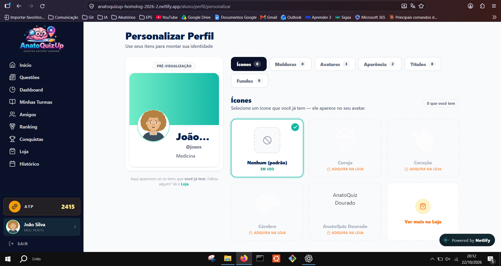

??? info "Captura 3_1.PNG"

    

??? info "Captura 4.PNG"

    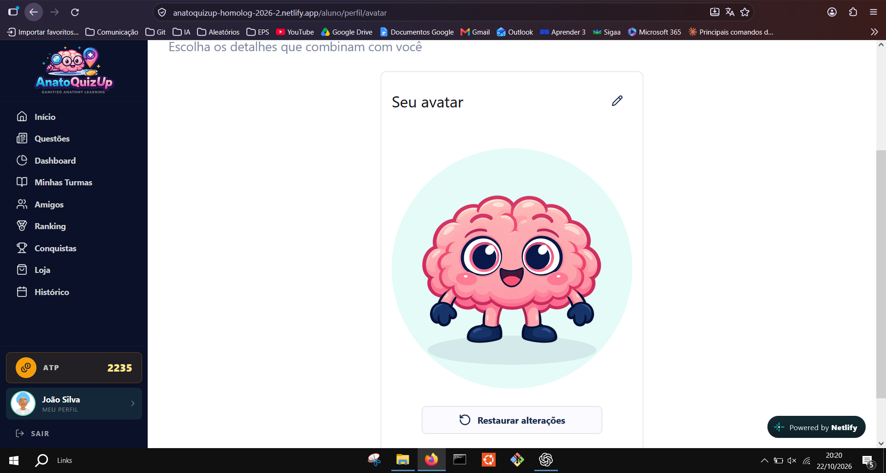

??? info "Captura 4_1.PNG"

    

??? info "Captura 4_2.PNG"

    

??? info "Captura 5.PNG"

    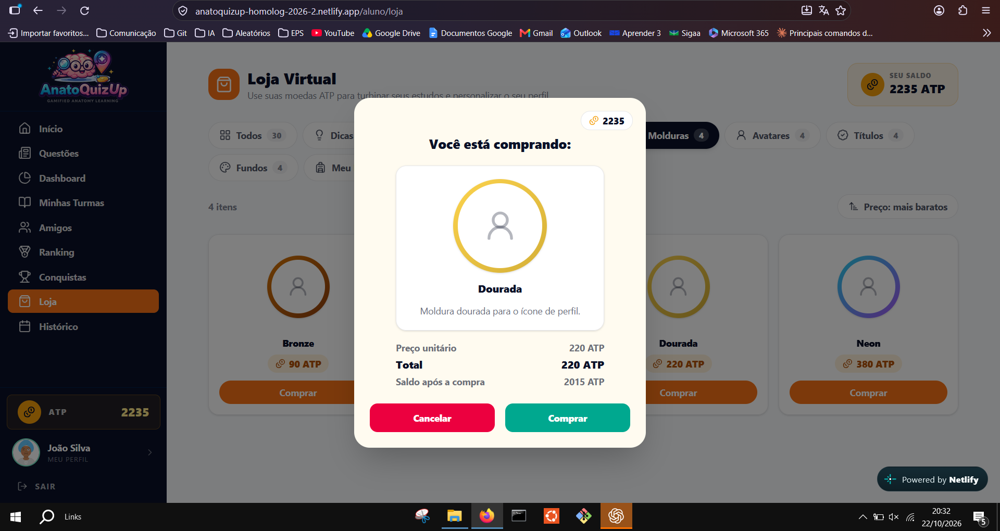

??? info "Captura 5_1.PNG"

    

??? info "Captura 6.PNG"

    

??? info "Captura 6_1.PNG"

    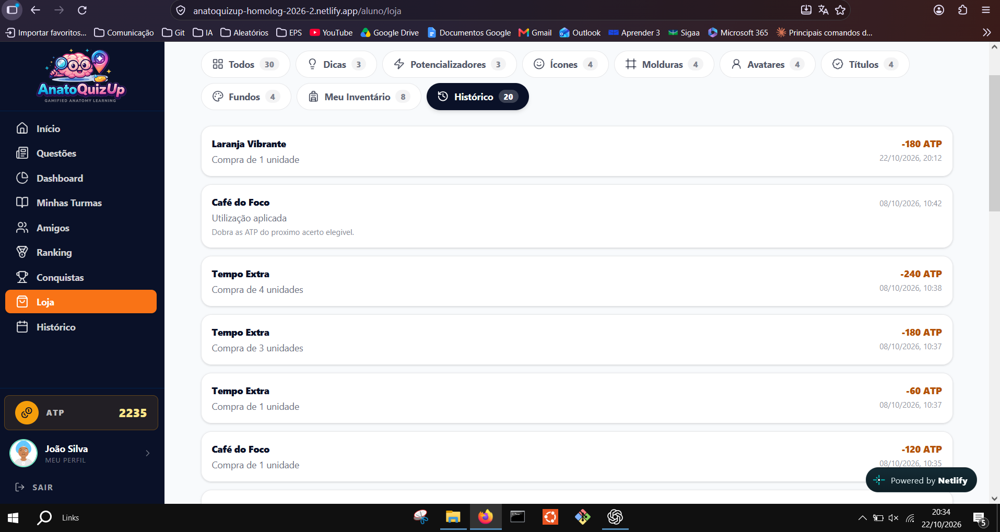

??? info "Captura 6_2.PNG"

    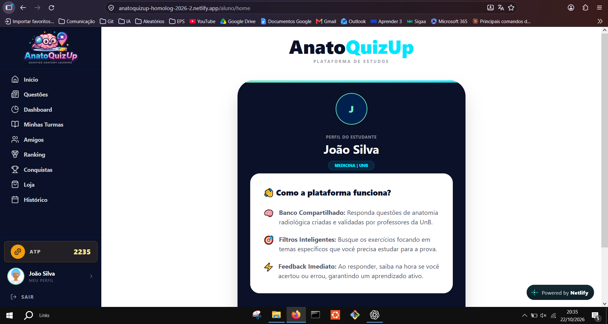

??? info "Captura 7.PNG"

    

??? info "Captura 7_1.PNG"

    

??? info "Captura 7_2.PNG"

    

??? info "Captura 8.PNG"

    

??? info "Captura 9.PNG"

    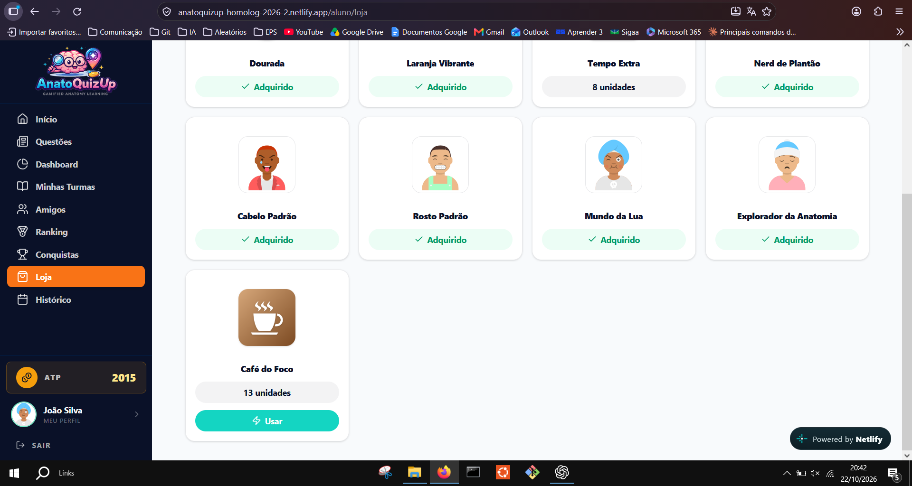

??? info "Captura 9_1.PNG"

    

??? info "Captura 10.PNG"

    

??? info "Captura 10_1.PNG"

    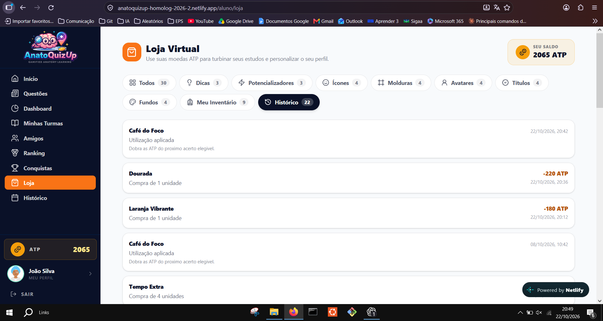

??? info "Captura 11.PNG"

    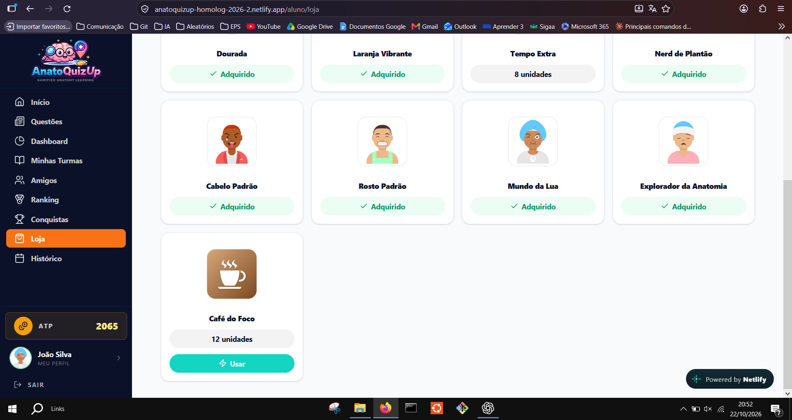

??? info "Captura 11_1.PNG"

    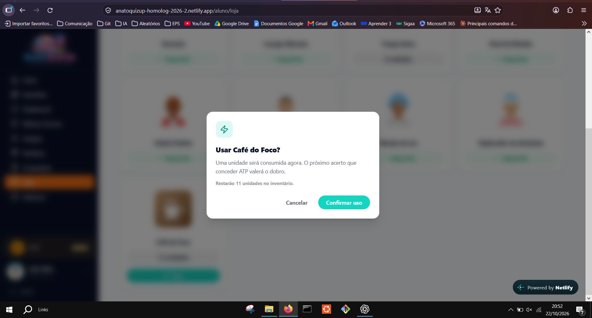

??? info "Captura 11_2.PNG"

    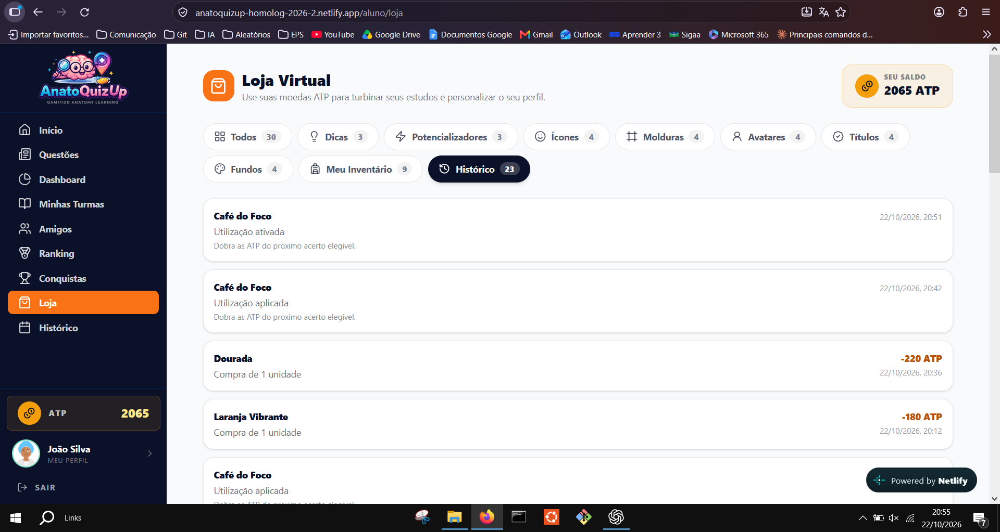

??? info "Captura 12.PNG"

    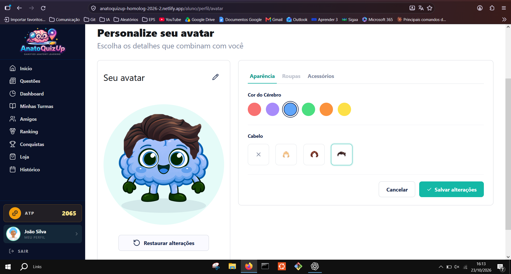

??? info "Captura 12_1.PNG"

    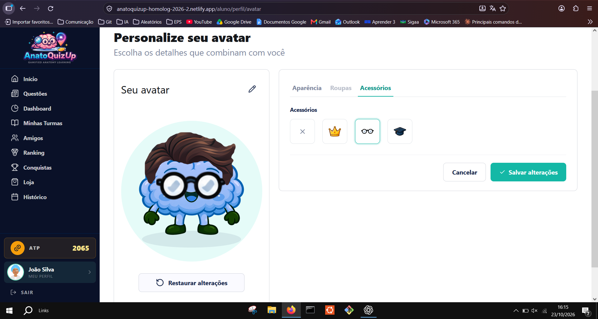

??? info "Captura 12_2.PNG"

    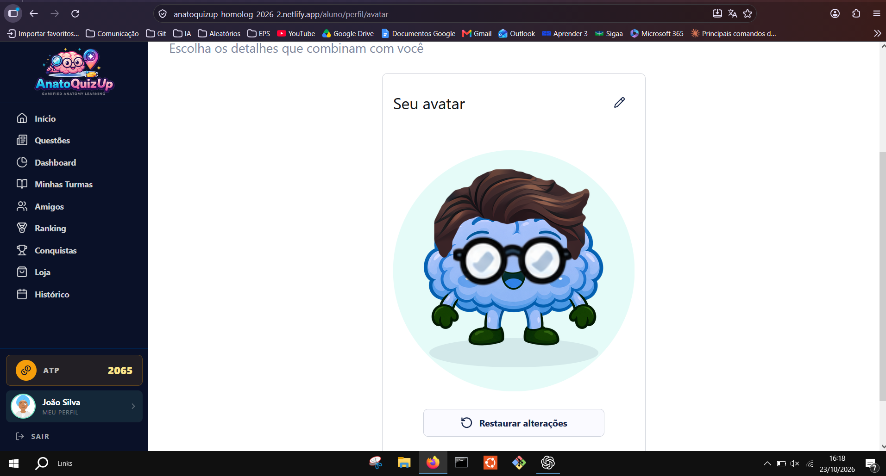

??? info "Captura 12_3.PNG"

    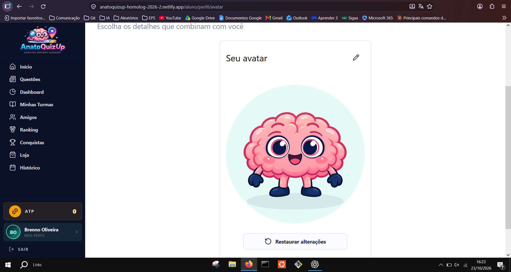

## Histórico de versão

| Data | Versão | Descrição | Autor | Revisor |
|---|---|---|---|---|
| 23/10/2026 | 1.0 | Resultados e evidências da execução em homologação | [Brenno Oliveira](https://github.com/Brenno-Silva01) | Revisão pendente |
