# Roteiro de testes de sistema — AnatoQuizUp

**Situação:** primeira rodada encerrada com pendências, executada entre 21 e 23/10/2026 sobre o deploy disponível em homologação. Foram registrados 9 casos aprovados, 2 com falha e 2 bloqueados. Esta rodada não representa validação da main mais recente; novas publicações receberão retestes e complementos.

**Issue:** [#73 — Devops: Elaborar roteiro de testes](https://github.com/fga-eps-mds/2026-2-AnatoQuizUp-Doc/issues/73).

## Resumo da rodada

| Resultado | Casos |
|---|---:|
| Passou | 9 |
| Falhou | 2 |
| Bloqueado | 2 |
| Parcialmente executado | 0 |
| Não executado | 0 |
| **Total planejado** | **13** |

**Achados:** D-01 — acesso direto/recarregamento de rota apresenta 404 do Netlify e impede concluir CT-AC-02; D-02 — segunda tentativa de ativação de café não informa o motivo do impedimento; P-01 — falta condição de item não adquirido para o avatar cérebro.

Os resultados se referem à versão de homologação observada durante a execução. A versão publicada exata ainda precisa ser identificada. As capturas estão disponíveis na seção de evidências desta página e nos links de cada caso. Os resultados apoiados apenas em relato do executor estão identificados. O detalhamento dos resultados está na seção 5.

## 1. Objetivo e escopo

Verificar, pela interface Web conectada ao BFF, aos serviços e aos bancos do ambiente de homologação, os fluxos de avatar, personalização, loja, potencializadores e histórico especificados na [Release Major 1](https://github.com/fga-eps-mds/2026-2-AnatoQuizUp-Doc/blob/main/docs/backlog/release-major-1.md).

Login e controle de acesso entram como verificações de apoio. Este roteiro não substitui testes unitários, de integração, de carga nem uma avaliação completa de segurança. Os resultados podem apoiar a aceitação, que deve ter responsável e registro próprios.

A categoria Roupas foi adiada para R2 no escopo da R1. XP/elos e melhorias posteriores de navegação e exibição do avatar devem receber casos adicionais quando o escopo da versão a validar for confirmado. Um PR aprovado ou integrado não comprova que sua versão já esteja publicada em homologação.

## 2. Preparação

Dados registrados para esta rodada:

| Informação | Valor |
|---|---|
| Endereço da homologação | https://anatoquizup-homolog-2026-2.netlify.app |
| Período de execução | 21 a 23/10/2026; horários individuais nas capturas. Fuso do executor: America/Sao_Paulo; fuso do sistema das capturas não confirmado independentemente. |
| Responsável pela execução | [Brenno Oliveira](https://github.com/Brenno-Silva01) |
| Navegador e versão | Firefox, conforme capturas; versão não informada |
| Dispositivo / resolução | Computador com Windows; resolução de exibição não confirmada |
| Versão ou commit publicado do Web | SHA exato não identificado. Em 22/10/2026, bundle público /assets/index-DwxRb5sh.js não contém recursos presentes na main b7a355a331e7d00d9ab23667a36d87f8295c4f94; homologação desatualizada em relação à main |
| Versão ou commit publicado do BFF | A confirmar |
| Versão ou commit publicado do Quiz-Service | A confirmar |
| Versão ou commit publicado do Usuario-Service | A confirmar |
| Evidência das versões publicadas | Consulta pública do frontend em 23/10/2026, descrita abaixo; link do deploy e SHAs dos serviços não disponibilizados |

### Controle de versão do ambiente — verificação em 22/10/2026

Verificação técnica do HTML e JavaScript públicos identificou o bundle `/assets/index-DwxRb5sh.js`. Comparado à main Web `b7a355a331e7d00d9ab23667a36d87f8295c4f94` (merge do PR #16, após o PR #14), o bundle não contém o identificador de menu `aluno-avatar` nem a rota de API `/usuarios/meu-avatar`. Ambos existem nos arquivos da main consultada. Portanto, a homologação Web não corresponde à versão mais recente da main. O SHA exato da publicação não foi identificado.

O frontend publicado aponta para `https://minio-homolog.up.railway.app/api/v1`; `/health` desse host responde identificando o BFF, mas sem versão ou SHA. As referências main consultadas dos serviços são BFF `a105fae263cb66a6b2b79e513f6256561094851d`, Quiz-Service `a06b9bad56e7b90fd6c429da62c38402549e2d87` (merge do PR #13 em 22/10/2026) e Usuario-Service `cbe1133a321ed81f5df112c8f7f64b4ea104e00c`. Essas referências identificam o código atual do GitHub, não comprovam os commits publicados nos serviços.

**Decisão inicial, posteriormente revista:** a execução foi pausada para aguardar identificação e atualização do ambiente. Os registros dessa verificação são históricos e não identificam a versão disponível em cada execução futura.

### Retomada sobre o deploy disponível — 23/10/2026

Por decisão do executor, continuar os casos sobre o deploy atualmente disponível em homologação e ampliar ou atualizar o roteiro quando novas versões forem publicadas. Consulta pública em 23/10/2026 às 16:10 (America/Sao_Paulo) retornou HTTP 200 na página inicial, com JavaScript `/assets/index-DwxRb5sh.js` e CSS `/assets/index-CsBMaz9i.css`. Esses identificadores ajudam a reconhecer o frontend observado, mas não identificam o commit publicado nem as versões dos serviços.

Preservar os resultados de 21 e 22/10/2026 e registrar a data real de cada nova execução. Nenhum caso foi reexecutado apenas por retomar o roteiro. A retomada começou pela parte pendente de CT-AV-02: categorias, disponibilidade das opções e atualização da prévia, concluída nesta rodada. Confirmar o estado da conta antes de usar valores ou itens registrados anteriormente.

Depois de uma nova publicação, criar outra rodada e repetir os fluxos afetados pelas mudanças, especialmente personalização e persistência do avatar. Persistência após logout no mesmo navegador, sozinha, não comprova gravação no serviço remoto. Os resultados desta rodada devem ser apresentados como validação do deploy observado, sem equipará-lo à main atual.

O responsável informou possuir contas de aluno, professor e administrador. Confirmar que são adequadas para testes e que os dados utilizados podem ser alterados. Em 23/10/2026, o executor confirmou a criação de uma segunda conta de aluno (aluno B), com primeiro acesso registrado em 12_3.PNG, disponível para CT-AV-01 e CT-AC-01. Não registrar senhas, tokens ou dados pessoais de usuários reais neste documento ou nas evidências.

Preparar um aluno novo sem personalização; saldo suficiente para uma compra; outra situação com saldo insuficiente; um item comprável com preço conhecido; uma opção de avatar disponível; e um potencializador com suas condições de uso documentadas. Confirmar como esses dados serão obtidos no ambiente de teste antes de executar casos que os alteram. Não editar bancos ou usar contas reais para preparar o roteiro.

Para cada compra e utilização, anotar os valores antes e depois. Casos podem depender de dados deixados pelos anteriores; registrar essa dependência e preparar os dados novamente ao repetir uma execução.

## 3. Como registrar

- **Não executado:** ainda não houve tentativa.
- **Execução parcial; evidência pendente:** houve relato de execução de parte do caso, mas faltam verificações ou evidências para concluir sua avaliação.
- **Passou:** todos os resultados esperados foram observados e há evidência.
- **Falhou:** o teste foi executado e houve diferença entre esperado e obtido.
- **Bloqueado:** não foi possível executar por falta de acesso, dados, versão publicada ou serviço disponível. Informar a causa.

Não marcar um caso como aprovado apenas porque a tela abriu. Confirmar os efeitos previstos, incluindo persistência e valores quando aplicável. Se o serviço estiver indisponível, registrar o bloqueio e abrir um defeito separado quando pertinente; isso não comprova aprovação do fluxo.

Nome sugerido de evidência: `CT-AV-02_2026-10-21_01.png`. Usar a data real de execução. Gravações são úteis para fluxos com várias etapas. Guardar evidências em local acessível à equipe e vincular abaixo.

## 4. Casos de teste

### CT-AU-01 — Entrar e encerrar a sessão

**Referência:** pré-condição dos fluxos da R1.

**Pré-condições:** conta de aluno de teste ativa; usuário deslogado.

1. Entrar com as credenciais válidas. **Esperado:** acesso à área autenticada da conta correta.
2. Encerrar a sessão. **Esperado:** retorno à área pública, sem acesso aos dados autenticados.
3. Tentar abrir diretamente uma página protegida e recarregá-la. **Esperado:** solicitação de autenticação, sem exibição de dados privados.

### CT-AV-01 — Avatar padrão no primeiro acesso

**Referência:** US01, [#27](https://github.com/fga-eps-mds/2026-2-AnatoQuizUp-Doc/issues/27).

**Pré-condições:** conta nova de aluno, sem personalização anterior; forma de criação da conta confirmada.

1. Acessar a conta pela primeira vez e abrir o perfil. **Esperado:** exibição do avatar padrão definido para a versão, sem imagem quebrada.
2. Sair e entrar novamente sem personalizar. **Esperado:** manutenção do mesmo avatar padrão.

### CT-AV-02 — Pré-visualizar e manter a personalização entre sessões

**Referência:** US02, [#26](https://github.com/fga-eps-mds/2026-2-AnatoQuizUp-Doc/issues/26).

**Pré-condições:** aluno A autenticado; opções de aparência e acessórios disponíveis no seu inventário.

1. Abrir a personalização e selecionar Aparência e Acessórios. **Esperado:** opções correspondentes a cada categoria.
2. Alterar a cor e equipar uma opção disponível. **Esperado:** pré-visualização atualizada antes de salvar.
3. Salvar, se houver controle explícito, e consultar novamente o avatar. **Esperado:** avatar com as escolhas salvas. Registrar a presença ou ausência de mensagem como observação de feedback; sua ausência, isoladamente, não reprova o requisito de persistência.
4. Sair, entrar novamente e consultar o perfil e a personalização. **Esperado:** escolhas mantidas após a nova sessão.

### CT-AV-03 — Impedir equipamento de item não adquirido

**Referência:** US02, #26.

**Pré-condições:** aluno autenticado; item de personalização não pertencente ao seu inventário identificado.

1. Localizar o item na personalização. **Esperado:** indicação de indisponibilidade e de aquisição na loja, conforme o requisito.
2. Tentar equipá-lo pelos controles disponíveis. **Esperado:** equipamento impedido.
3. Consultar o avatar salvo e o inventário. **Esperado:** item não equipado nem concedido; estado anterior preservado.

### CT-AV-04 — Restaurar o padrão preservando o inventário

**Referência:** US02, #26.

**Pré-condições:** aluno com avatar personalizado e itens adquiridos; inventário inicial registrado.

1. Restaurar a caracterização padrão e salvar. **Esperado:** avatar padrão exibido.
2. Sair e entrar novamente. **Esperado:** avatar padrão mantido.
3. Consultar o inventário. **Esperado:** itens adquiridos continuam disponíveis, sem perda decorrente da restauração.

### CT-LJ-01 — Comprar com saldo suficiente

**Referência:** US03, [#28](https://github.com/fga-eps-mds/2026-2-AnatoQuizUp-Doc/issues/28), [#35](https://github.com/fga-eps-mds/2026-2-AnatoQuizUp-Doc/issues/35).

**Pré-condições:** aluno autenticado; item e quantidade válidos; saldo suficiente; preço, saldo e inventário iniciais registrados.

1. Selecionar o item e a quantidade. **Esperado:** confirmação com item, quantidade e valor coerentes com o catálogo.
2. Confirmar uma única compra. **Esperado:** mensagem de sucesso; item ou quantidade adicionados ao inventário; desconto exatamente igual ao valor confirmado, uma única vez.
3. Recarregar a página e consultar o histórico. **Esperado:** saldo e inventário persistidos; um registro correspondente à compra.

### CT-LJ-02 — Cancelar uma compra

**Referência:** confirmação de compra da US03, #35.

**Pré-condições:** aluno autenticado; saldo, inventário e histórico iniciais registrados.

1. Selecionar um item e abrir a confirmação. **Esperado:** resumo da compra antes de sua efetivação.
2. Cancelar a operação. **Esperado:** nenhuma compra concluída.
3. Conferir saldo, inventário e histórico, inclusive após recarregar. **Esperado:** nenhum desconto, concessão de item ou registro de compra decorrente do cancelamento.

### CT-LJ-03 — Comprar sem saldo suficiente

**Referência:** US03, #28 e #35.

**Pré-condições:** aluno com saldo inferior ao preço da compra; valores iniciais registrados.

1. Tentar comprar o item. **Esperado:** operação impedida com indicação compreensível de saldo insuficiente.
2. Conferir saldo, inventário e histórico após recarregar. **Esperado:** nenhum débito ou concessão de item; nenhuma compra bem-sucedida registrada para a tentativa.

### CT-PT-01 — Utilizar um potencializador válido

**Referência:** US03, [#38](https://github.com/fga-eps-mds/2026-2-AnatoQuizUp-Doc/issues/38).

**Pré-condições:** aluno com ao menos uma unidade de um potencializador; quantidade inicial registrada. Antes de executar, preencher: **item = ___; condição de uso = ___; efeito esperado observável = ___; fonte da regra = ___**. Sem esses dados, o caso fica bloqueado.

1. Acessar o contexto que atende à condição de uso e selecionar o potencializador. **Esperado:** possibilidade de uso conforme a regra registrada.
2. Confirmar uma utilização. **Esperado:** efeito registrado aplicado e quantidade reduzida em exatamente uma unidade.
3. Consultar inventário e histórico após recarregar. **Esperado:** consumo persistido e um registro correspondente ao uso.

### CT-PT-02 — Impedir utilização inválida

**Referência:** US03, #38.

**Pré-condições:** repetir o caso para cada situação aplicável: item sem unidades e item com condição de uso não atendida. Registrar a condição e a regra correspondente. Registrar inventário e estado inicial do efeito. Uma condição identificada no código de referência é tentar ativar outro Café do Foco enquanto já existe um ativo, antes do próximo acerto elegível; essa é a condição executada abaixo. A condição sem unidades permanece não executada.

1. Tentar utilizar o item pelos controles disponíveis. **Esperado:** utilização impedida, com indicação do motivo.
2. Conferir inventário, efeito e histórico. **Esperado:** nenhuma quantidade negativa, efeito indevido ou utilização bem-sucedida registrada.

### CT-HI-01 — Consultar histórico de compras e utilizações

**Referência:** US03, [#40](https://github.com/fga-eps-mds/2026-2-AnatoQuizUp-Doc/issues/40).

**Pré-condições:** aluno com uma compra e uma utilização bem-sucedidas desta execução, com dados e horários anotados.

1. Abrir o histórico. **Esperado:** presença dos registros de compra e utilização correspondentes às operações anotadas.
2. Comparar os dados apresentados com item, quantidade e valores registrados, quando aplicáveis ao tipo de operação. **Esperado:** coerência com as operações efetivadas.
3. Sair, entrar novamente e consultar o histórico. **Esperado:** registros mantidos e sem duplicações causadas pela consulta.

### CT-AC-01 — Preservar a personalização de outra conta

**Referência:** controle de acesso das US01 e US02, #27 e #26.

**Pré-condições:** contas de alunos A e B com aparências identificáveis e registradas; usar sessões separadas ou encerrar completamente uma sessão antes de trocar de conta.

1. Personalizar e salvar o avatar de A. **Esperado:** mudança aplicada a A.
2. Entrar como B e consultar sua própria personalização. **Esperado:** estado anterior de B preservado, sem herdar as escolhas de A.
3. Alterar e salvar B; voltar à conta A. **Esperado:** escolhas de A preservadas.

**Limite:** este caso verifica isolamento observado na interface. Não comprova sozinho a autorização da API contra requisições manipuladas; essa verificação deve ter caso e evidência próprios.

### CT-AC-02 — Restringir edição de avatar ao aluno autenticado

**Referência:** controle de acesso das US01 e US02, #27 e #26.

**Pré-condições:** URL da personalização identificada; conta de professor de teste disponível.

1. Sem autenticação, tentar abrir diretamente a personalização. **Esperado:** acesso à edição negado, sem alteração de avatar.
2. Entrar como professor e tentar acessar a mesma página. **Esperado:** edição de avatar de aluno indisponível, sem alteração de dados.
3. Entrar como aluno. **Esperado:** acesso à edição do próprio avatar permitido.

## 5. Registro da execução

Preencher uma linha por caso; para CT-PT-02, registrar separadamente cada condição executada. Se repetir a execução, manter o registro anterior e criar nova rodada identificada.

| Caso | Resultado |
|---|---|
| [CT-AU-01](#resultado-ct-au-01) | Falhou |
| [CT-AV-01](#resultado-ct-av-01) | Passou |
| [CT-AV-02](#resultado-ct-av-02) | Passou |
| [CT-AV-03](#resultado-ct-av-03) | Bloqueado |
| [CT-AV-04](#resultado-ct-av-04) | Passou |
| [CT-LJ-01](#resultado-ct-lj-01) | Passou |
| [CT-LJ-02](#resultado-ct-lj-02) | Passou |
| [CT-LJ-03](#resultado-ct-lj-03) | Passou |
| [CT-PT-01](#resultado-ct-pt-01) | Passou |
| [CT-PT-02](#resultado-ct-pt-02) | Falhou |
| [CT-HI-01](#resultado-ct-hi-01) | Passou |
| [CT-AC-01](#resultado-ct-ac-01) | Passou |
| [CT-AC-02](#resultado-ct-ac-02) | Bloqueado |

### Resultado CT-AU-01

**Status:** Falhou.

Acesso à área do aluno observado; abertura direta de /aluno/perfil apresentou página 404 do Netlify, sem a solicitação de autenticação esperada. Encerramento efetivo da sessão ainda não comprovado.

**Evidências:** [1_1.PNG](evidencias/rodada-2026-10/1_1.PNG), [2.PNG](evidencias/rodada-2026-10/2.PNG)

**Observações:** D-01, registro local abaixo

### Resultado CT-AV-01

**Status:** Passou.

Em 23/10/2026, executor confirmou conta nova de aluno em primeiro acesso. Captura das 16:23 mostra avatar padrão rosa, sem cabelo ou acessório, com luvas e calçados azuis, sem imagem quebrada e saldo de 0 ATP. Sem personalizar, o executor saiu e entrou novamente e confirmou que o avatar permaneceu igual.

**Evidências:** [12_3.PNG — primeiro acesso](evidencias/rodada-2026-10/12_3.PNG), com relato do executor sobre criação, primeiro acesso e manutenção do padrão após novo login; sem nova captura da sessão

**Observações:** Nenhuma falha relatada neste caso

### Resultado CT-AV-02

**Status:** Passou.

Execução iniciada em 22/10 e complementada em 23/10/2026. Aparência e Acessórios exibem opções disponíveis; executor confirmou atualização imediata da prévia antes de salvar. Após Salvar alterações, não apareceu mensagem de confirmação. Executor saiu e entrou novamente e confirmou manutenção do cérebro azul, cabelo castanho e óculos, visíveis na captura das 16:18. Saldo exibido mantido em 2065 ATP.

**Evidências:** [12.PNG — Aparência](evidencias/rodada-2026-10/12.PNG), [12_1.PNG — Acessórios e prévia](evidencias/rodada-2026-10/12_1.PNG), [12_2.PNG — estado após novo login](evidencias/rodada-2026-10/12_2.PNG), com relato do executor sobre prévia, salvamento e nova sessão; evidências anteriores preservadas em O-01

**Observações:** O-01: ausência de mensagem explícita, sem reprovação isolada do requisito. Permanência observada no mesmo navegador; não comprova persistência remota ou aquisição dos itens.

### Resultado CT-AV-03

**Status:** Bloqueado.

Executor informou que todos os itens de personalização do avatar cérebro estão liberados e não há peças desse avatar para comprar na loja. Não foi possível preparar a condição de item não adquirido; a restrição de equipamento não foi exercitada.

**Evidências:** Relato do executor; captura da edição e do catálogo ainda não anexada

**Observações:** P-01: conciliar requisito de inventário/compra do avatar com a versão publicada

### Resultado CT-AV-04

**Status:** Passou.

Em 22/10/2026, o avatar personalizado foi restaurado ao padrão rosa sem chapéu, com luvas e calçados azuis. A captura mostra “Avatar restaurado ao padrão”. Executor confirmou que o padrão permaneceu após novo login e os itens disponíveis antes continuaram disponíveis. A verificação de disponibilidade baseia-se no relato, sem comparação visual do inventário anexada; não comprova aquisição prévia desses itens.

**Evidências:** [4_1.PNG — antes](evidencias/rodada-2026-10/4_1.PNG), [4_2.PNG — após restaurar](evidencias/rodada-2026-10/4_2.PNG), com relato do executor sobre persistência e disponibilidade dos itens

**Observações:** Nenhuma falha relatada neste fluxo; preservação de itens comprovadamente adquiridos requer inventário de teste identificado

### Resultado CT-LJ-01

**Status:** Passou.

Em 22/10/2026, compra de uma moldura Dourada por 220 ATP: saldo de 2235 para 2015 ATP, mensagem Compra concluída e item adicionado ao inventário. Contador do inventário passa de 8 para 9 tipos; histórico de 20 para 21 registros, com uma compra de Dourada de 1 unidade por -220 ATP às 20:36. Executor confirmou manutenção de saldo e item após novo login.

**Evidências:** [5.PNG — preço e saldo de referência](evidencias/rodada-2026-10/5.PNG), [7.PNG — sucesso](evidencias/rodada-2026-10/7.PNG), [7_1.PNG — inventário](evidencias/rodada-2026-10/7_1.PNG), [7_2.PNG — histórico](evidencias/rodada-2026-10/7_2.PNG), com relato de persistência após novo login

**Observações:** Nenhuma falha relatada nesta compra

### Resultado CT-LJ-02

**Status:** Passou.

Em 22/10/2026, a confirmação da moldura Dourada por 220 ATP foi fechada sem compra. Saldo de 2235 ATP preservado; item continua com Comprar. Inventário mostra 8 tipos de itens e não inclui Dourada. Histórico permanece com contador 20; o registro mais recente visível é Laranja Vibrante às 20:12, sem compra da moldura no horário do teste (20:32–20:35). Nova navegação para Início mantém saldo de 2235 ATP. Evidências confirmam o cancelamento observado na interface; persistência por recarga direta não exercitada devido a D-01.

**Evidências:** [5.PNG — confirmação](evidencias/rodada-2026-10/5.PNG), [5_1.PNG — após cancelamento](evidencias/rodada-2026-10/5_1.PNG), [6.PNG — inventário](evidencias/rodada-2026-10/6.PNG), [6_1.PNG — histórico](evidencias/rodada-2026-10/6_1.PNG), [6_2.PNG — nova navegação](evidencias/rodada-2026-10/6_2.PNG)

**Observações:** Nenhuma falha observada no cancelamento; navegação pelo menu usada em lugar da recarga devido a D-01

### Resultado CT-LJ-03

**Status:** Passou.

Em 22/10/2026, com saldo de 2015 ATP, a compra de Café do Foco (120 ATP/unidade) limita a seleção a 16 unidades (1920 ATP, saldo previsto 95 ATP); botão + aparece desabilitado. A 17ª unidade elevaria o total a 2040 ATP. Executor relatou que não conseguiu aumentar além do saldo e que os demais dados continuaram iguais. Inventário inicial do item: 14 unidades.

**Evidências:** [8.PNG — limite de quantidade](evidencias/rodada-2026-10/8.PNG), com relato de manutenção de saldo, inventário e histórico

**Observações:** Aprovado para prevenção de saldo insuficiente pela interface. Não foi enviada compra acima do saldo; rejeição de requisição inválida diretamente pela API e mensagem de erro nessa condição não foram verificadas

### Resultado CT-PT-01

**Status:** Passou.

Em 22/10/2026, Café do Foco foi ativado: inventário de 14 para 13 unidades, saldo mantido em 2015 ATP e histórico de 21 para 22 registros. Às 20:42, registro Utilização ativada. Acerto em questão de dificuldade MEDIA às 20:47 mostra +50 ATP, indicação Café do Foco: +25 ATP extras e saldo de 2065 ATP, coerente com 25 ATP base mais 25 extras. Captura às 20:49 confirma mudança para Utilização aplicada, mantendo o contador do histórico em 22 e saldo em 2065 ATP. Executor confirmou, após sair e entrar novamente, saldo de 2065 ATP, 13 cafés e manutenção dos registros no histórico. Essa persistência foi atestada por relato, sem nova captura da sessão.

**Evidências:** [8.PNG — quantidade anterior](evidencias/rodada-2026-10/8.PNG), [9.PNG — 13 unidades](evidencias/rodada-2026-10/9.PNG), [9_1.PNG — ativação](evidencias/rodada-2026-10/9_1.PNG), [10.PNG — recompensa](evidencias/rodada-2026-10/10.PNG), [10_1.PNG — aplicação no histórico](evidencias/rodada-2026-10/10_1.PNG)

**Observações:** Consumo, recompensa dobrada e aplicação no histórico observados; persistência confirmada pelo executor

### Resultado CT-PT-02

**Status:** Falhou.

Em 22/10/2026, executor ativou mais um Café do Foco (13 para 12 unidades) e, sem responder questões, tentou confirmar outro uso. Relatou que a quantidade permaneceu em 12, mas nenhuma mensagem apareceu ao confirmar. Captura mostra saldo de 2065 ATP e 12 unidades; modal da nova tentativa prevê 11 unidades, mas não informa que há uso ativo. Bloqueio do consumo aparente foi observado por relato; explicação do motivo não foi apresentada. Captura posterior mostra histórico de 22 para 23 registros, com uma única nova ativação às 20:51, preservando a utilização anterior aplicada às 20:42 e saldo de 2065 ATP.

**Evidências:** [11.PNG — 12 unidades](evidencias/rodada-2026-10/11.PNG), [11_1.PNG — nova confirmação](evidencias/rodada-2026-10/11_1.PNG), [11_2.PNG — histórico sem ativação duplicada](evidencias/rodada-2026-10/11_2.PNG), com relato sobre ausência de mensagem e manutenção da quantidade após confirmar

**Observações:** D-02: tentativa inválida sem explicação; ausência de ativação adicional observada no histórico. Variante sem unidades ainda não executada

### Resultado CT-HI-01

**Status:** Passou.

Histórico unificado mostra compra de Dourada de 1 unidade por -220 ATP às 20:36 e uso de Café do Foco ativado às 20:42, posteriormente atualizado para Utilização aplicada. Contador passa de 21 para 22 na ativação e permanece em 22 após aplicação, sem novo registro dessa utilização nas evidências. Executor confirmou que a compra de Dourada e a utilização de Café do Foco permaneceram no histórico após sair e entrar novamente; confirmação por relato, sem nova captura da sessão.

**Evidências:** [7_2.PNG — compra](evidencias/rodada-2026-10/7_2.PNG), [9_1.PNG — ativação](evidencias/rodada-2026-10/9_1.PNG), [10_1.PNG — aplicação](evidencias/rodada-2026-10/10_1.PNG)

**Observações:** Nenhuma falha relatada na consulta e persistência do histórico

### Resultado CT-AC-01

**Status:** Passou.

Em 23/10/2026, a conta A (João) havia sido personalizada em azul, com cabelo castanho e óculos. A conta nova B exibiu o padrão sem herdar as escolhas de A. Após orientação para personalizar e salvar B com aparência diferente e retornar a A, o executor confirmou que tudo ocorreu conforme esperado: B recebeu suas escolhas e João manteve sua aparência anterior. As escolhas exatas de B não foram informadas; verde, sem cabelo e com coroa foram apenas sugestões de execução.

**Evidências:** [12_2.PNG — estado de referência de A](evidencias/rodada-2026-10/12_2.PNG), [12_3.PNG — estado inicial de B](evidencias/rodada-2026-10/12_3.PNG), com relato do executor sobre alteração de B e preservação de A; sem novas capturas dessa sequência

**Observações:** Isolamento observado pela interface no mesmo navegador; não comprova autorização da API nem persistência remota

### Resultado CT-AC-02

**Status:** Bloqueado.

Em 23/10/2026, executor autenticado como professor informou que não existe opção de editar avatar de aluno no menu. Ao acessar diretamente /aluno/perfil/avatar, recebeu Page not found do Netlify. A ausência da opção no menu foi verificada por relato; a autorização da rota pela aplicação não pôde ser avaliada porque a hospedagem respondeu 404 antes de carregar a interface. A variante sem autenticação não foi executada nesta retomada. A edição como aluno foi observada em CT-AV-02.

**Evidências:** Relato do executor e transcrição da página 404; sem nova captura anexada

**Observações:** D-01 impede concluir a verificação de autorização por acesso direto; repetir após corrigir o acesso às rotas

Ao reportar um defeito, informar caso, ambiente, versão publicada, passos, resultado esperado, resultado obtido e evidência. Vincular a issue do defeito; após a correção, registrar a versão corrigida e repetir o caso e os fluxos afetados.

### Observação de execução — Personalização do cartão de perfil

Em 22/10/2026 foram recebidas as capturas [3.PNG](evidencias/rodada-2026-10/3.PNG) e [3_1.PNG](evidencias/rodada-2026-10/3_1.PNG) da página “Personalizar Perfil”, em `/aluno/perfil/personalizar`, às 20:12 e 20:14 segundo o relógio exibido nas imagens. A primeira mostra personagem humano com cabelo castanho e fundo verde; a segunda mostra outro personagem humano e fundo laranja, também refletido no ícone do menu lateral. O executor relatou confirmação de salvamento e manutenção da aparência após novo login; as capturas isoladas não mostram a sequência de logout/login.

O saldo exibido mudou de 2415 para 2235 ATP e o contador de Fundos passou de 0 para 1. O executor confirmou posteriormente que comprou o fundo laranja durante o processo. A diferença observada é de 180 ATP; ainda não houve verificação independente do preço exibido, da confirmação da compra e do histórico para aprovar CT-LJ-01 integralmente.

Essas evidências documentam a personalização visual do cartão de perfil, separada do avatar cérebro requerido nas US01/US02. As evidências posteriores [4.PNG](evidencias/rodada-2026-10/4.PNG) e [4_1.PNG](evidencias/rodada-2026-10/4_1.PNG) documentam o personagem correto no CT-AV-02. Registrar a personalização do cartão como caso adicional separado se o requisito correspondente for identificado.

### Complemento de CT-AV-02 — Edição aberta em 23/10/2026

Evidência [12.PNG](evidencias/rodada-2026-10/12.PNG), com relógio exibindo 16:13 de 23/10/2026. A página `/aluno/perfil/avatar` mostra o editor aberto na categoria Aparência, opções de cor do cérebro e cabelo, aba Acessórios disponível e aba Roupas visualmente desabilitada. A cor azul e o cabelo castanho selecionados correspondem ao avatar exibido à esquerda. Os controles Cancelar e Salvar alterações estão visíveis; saldo exibido de 2065 ATP.

A captura comprova a presença dos controles e a correspondência visual entre seleção e avatar. A aba Roupas não será exigida nesta rodada, conforme o escopo R1 registrado.

Na sequência, a evidência [12_1.PNG](evidencias/rodada-2026-10/12_1.PNG), às 16:15 de 23/10/2026 segundo o relógio exibido, mostra a aba Acessórios aberta, com opções de remoção, coroa, óculos e chapéu de formatura. Os óculos estão selecionados e aparecem na prévia do avatar azul com cabelo castanho; saldo de 2065 ATP. O executor confirmou que a prévia mudou conforme esperado antes do salvamento. As verificações de navegação entre Aparência e Acessórios e de atualização da prévia foram atendidas. As opções selecionadas estão disponíveis na interface, mas não há comprovação de aquisição desses itens, conforme P-01. Naquele momento, CT-AV-02 permanecia parcial; o salvamento e a permanência foram confirmados depois, conforme a conclusão de 23/10/2026. A execução anterior foi preservada.

### Pendência P-01 — Itens do avatar liberados sem aquisição na loja

O executor informou que os itens do avatar cérebro estão liberados e que a loja não oferece peças para personalizar esse personagem. Portanto, não existe, nas condições relatadas, item não adquirido que permita executar CT-AV-03. Registrar o caso como bloqueado, sem contabilizá-lo como aprovado.

A US02 consultada prevê inventário e impedimento de equipamento de item não adquirido. Confirmar com a equipe e o responsável pelo produto se essa regra permanece no escopo da versão avaliada, se o catálogo está incompleto ou se há mudança de requisito formalmente registrada. Não presumir falha de autorização nem alterar a expectativa apenas para adequá-la ao comportamento atual. A personalização do cartão de perfil e sua loja não substituem automaticamente o requisito do avatar cérebro.

Essa informação também limita CT-AV-04: o retorno ao padrão e a manutenção das opções disponíveis foram verificados, mas a preservação de itens adquiridos especificamente para o avatar cérebro não pôde ser exercitada. O resultado positivo da restauração não comprova integralmente a integração entre loja, inventário e avatar.

### Observação O-01 — Sem mensagem explícita após personalizar o avatar cérebro

Nas capturas [4.PNG](evidencias/rodada-2026-10/4.PNG) e [4_1.PNG](evidencias/rodada-2026-10/4_1.PNG), recebidas em 22/10/2026, o avatar cérebro muda de rosa sem acessório para azul com chapéu de formatura e luvas/calçados verdes, em `/aluno/perfil/avatar`. O saldo exibido permanece 2235 ATP. O executor informou que as escolhas permaneceram após sair e entrar novamente, mas não apareceu confirmação de salvamento. As imagens mostram os estados visuais; a sequência do novo login é evidenciada pelo relato do executor.

Registrar a persistência como resultado positivo da etapa executada. A ausência de mensagem explícita é uma observação de feedback ao usuário; a US02 consultada exige salvar e manter a personalização, mas não especifica obrigatoriedade de uma mensagem. A expressão “confirmação de sucesso” adicionada no passo 3 deste rascunho deve ser tratada como verificação de feedback, sem transformar, por si só, sua ausência em descumprimento do requisito de persistência. Confirmar se há critério de UX adicional com a equipe.

### Registro D-02 — Segunda ativação do Café do Foco não explica o impedimento

**Situação:** achado registrado localmente; issue de defeito não criada; correção e reteste pendentes.

**Caso:** CT-PT-02, condição de uso já ativo. **Ambiente:** homologação. **Versão publicada:** não identificada.

**Preparação e passos:** após concluir a utilização anterior, ativar um Café do Foco do inventário com 13 unidades (quantidade passa a 12). Sem responder outra questão, selecionar Usar novamente e Confirmar uso.

**Esperado:** impedir uma segunda ativação enquanto a anterior estiver ativa, preservar 12 unidades e explicar o motivo. Exemplo de orientação: já existe um café ativo; é necessário um acerto elegível antes de ativar outro. A exigência de informar o motivo de utilização inválida está no backlog da US03 consultado.

**Obtido:** executor informou que a quantidade não diminui para 11 e não aparece mensagem após confirmar. A captura da confirmação continua oferecendo a ação e prevê “Restarão 11 unidades no inventário”. Não há evidência de um segundo consumo efetivado. A captura posterior [11_2.PNG](evidencias/rodada-2026-10/11_2.PNG), às 20:55 segundo o relógio exibido, mostra 23 registros (antes eram 22), uma única nova ativação às 20:51, a utilização anterior aplicada às 20:42 e saldo preservado em 2065 ATP. Portanto, não foi observado registro de ativação adicional decorrente da tentativa inválida.

**Evidências:** [11.PNG](evidencias/rodada-2026-10/11.PNG) e [11_1.PNG](evidencias/rodada-2026-10/11_1.PNG), às 20:52 de 22/10/2026 segundo o relógio das capturas; [11_2.PNG](evidencias/rodada-2026-10/11_2.PNG), às 20:55; e relato do executor sobre o clique em confirmar. Não foram inspecionadas requisições ou respostas da API; não atribuir a causa ao frontend ou backend sem investigação.

**Reteste:** repetir com um café já ativo, verificar mensagem clara de impedimento, quantidade e saldo preservados e ausência de um registro de ativação adicional. Não é necessário consumir repetidamente itens para reproduzir.

### Registro D-01 — Acesso direto ao perfil apresenta página 404 da hospedagem

**Situação:** achado registrado localmente; issue de defeito ainda não criada; correção e reteste pendentes.

**Caso:** CT-AU-01. **Ambiente:** homologação informada na seção 2. **Versão publicada:** ainda não identificada.

**Evidências recebidas do executor:** captura [1_1.PNG](evidencias/rodada-2026-10/1_1.PNG), mostrando a área do aluno em `/aluno/home`; captura [2.PNG](evidencias/rodada-2026-10/2.PNG), mostrando `/aluno/perfil` com a mensagem “Page not found” do Netlify. As capturas exibem 21/10/2026, às 16:04 e 16:06, respectivamente, no relógio do computador; fuso e versão do navegador não confirmados.

**Resultado esperado do caso:** após encerrar a sessão e acessar diretamente uma página protegida, solicitar autenticação e impedir a exibição de dados privados.

**Resultado observado:** a URL direta de perfil exibiu a página 404 da hospedagem. As imagens não mostram a sequência do logout, nem comprovam a invalidação da sessão. Não foi observada exposição de dados privados na segunda captura.

**Reprodução complementar informada pelo executor:** após realizar novo login, o perfil abriu pela navegação da aplicação; ao pressionar F5 no perfil, voltou a aparecer a página “Page not found” do Netlify. Portanto, a falha de recarregamento também ocorre durante uma sessão autenticada e não depende do logout.

**Contexto documental conferido em 23/10/2026:** o [guia de homologação](https://github.com/fga-eps-mds/2026-2-AnatoQuizUp-Doc/blob/main/docs/operacao/ambiente-homologacao.md) já registra, em Limitações conhecidas, o 404 no acesso direto/recarregamento de rotas por falta de fallback SPA no Netlify. Portanto, D-01 reproduz uma limitação conhecida, não constitui descoberta inédita. O resultado do teste permanece Falhou, pois o comportamento esperado não é atendido. A configuração efetivamente publicada ainda deve ser conferida antes da correção e do reteste.

**Complemento necessário:** confirmar com o executor a realização do logout na execução inicial e anexar a evidência do recarregamento autenticado. Inspecionar a configuração de rotas efetivamente publicada. Após corrigir o acesso às rotas, repetir integralmente CT-AU-01 para verificar o comportamento de autenticação.

**Evidências publicadas:** as capturas utilizadas estão na seção 7 e na pasta de evidências desta página. Os arquivos originais foram preservados, sem alterações nas imagens.

## 6. Conclusão da rodada e próximos retestes

Esta rodada registra os fluxos executados no deploy disponível, com limites explícitos. Os casos aprovados não eliminam as falhas e os bloqueios encontrados; os resultados não representam aceite formal do produto.

| Pendência | Próxima ação |
|---|---|
| D-01: 404 em rotas internas | Publicar a correção de fallback e repetir CT-AU-01 e CT-AC-02, incluindo acesso sem autenticação e como professor. |
| D-02: café já ativo sem orientação | Informar o impedimento na interface e repetir a tentativa, conferindo quantidade, saldo e histórico. |
| P-01: itens do avatar disponíveis sem aquisição | Confirmar a regra com a equipe e preparar item não adquirido, se aplicável, para CT-AV-03 e a verificação de inventário de CT-AV-04. |
| CT-PT-02: variante sem unidades | Preparar uma conta sem unidades do item, sem consumir repetidamente o estoque atual, e executar a variante. |
| Versões publicadas e persistência remota | Identificar os SHAs dos componentes e complementar a verificação de persistência entre navegadores ou dispositivos. |
| Evidências por relato | Complementar capturas ou gravações de isolamento entre contas e das verificações ainda documentadas somente por relato, quando possível. |

Após nova publicação, abrir outra rodada identificada por data e versão. Preservar esta execução e repetir os fluxos afetados. A revisão da documentação e o aceite do produto devem identificar seus responsáveis, sem atribuir aprovação ao PO apenas pela execução do roteiro.

Este roteiro não comprova cobertura integral de todas as exigências do professor. A ampliação para outras funcionalidades, acessibilidade, desempenho e testes de API depende do escopo acordado e dos respectivos critérios verificáveis.

### Conclusão de CT-AV-02 — 23/10/2026

O executor confirmou que, após Salvar alterações, nenhuma mensagem de confirmação foi exibida. Após sair e entrar novamente, as escolhas permaneceram. A evidência [12_2.PNG](evidencias/rodada-2026-10/12_2.PNG), às 16:18 segundo o relógio exibido, mostra cérebro azul, cabelo castanho, óculos, luvas e calçados verdes, com saldo de 2065 ATP. Em conjunto com 12.PNG, 12_1.PNG e o relato, conclui a parte pendente do caso: categorias, prévia e salvamento com permanência entre sessões. Resultado: Passou para o comportamento observado pela interface no mesmo navegador. Não foi verificada persistência em outro navegador ou diretamente no serviço. A ausência de mensagem permanece como observação O-01; a limitação de aquisição dos itens permanece em P-01.

## 7. Evidências da rodada

Expanda cada item para visualizar a captura original. As imagens registram estados observados; sequências de ações confirmadas por relato estão identificadas nos resultados.

??? info "Captura 1_1.PNG"

    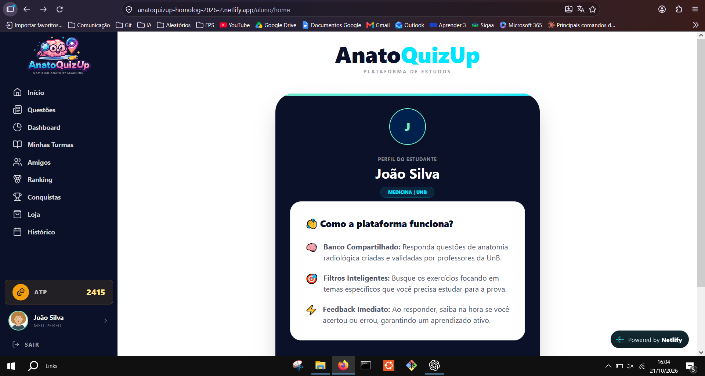

??? info "Captura 2.PNG"

    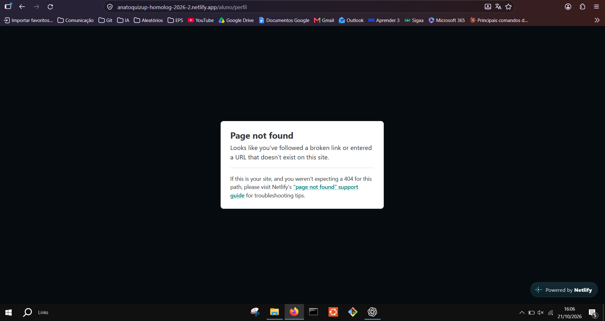

??? info "Captura 3.PNG"

    

??? info "Captura 3_1.PNG"

    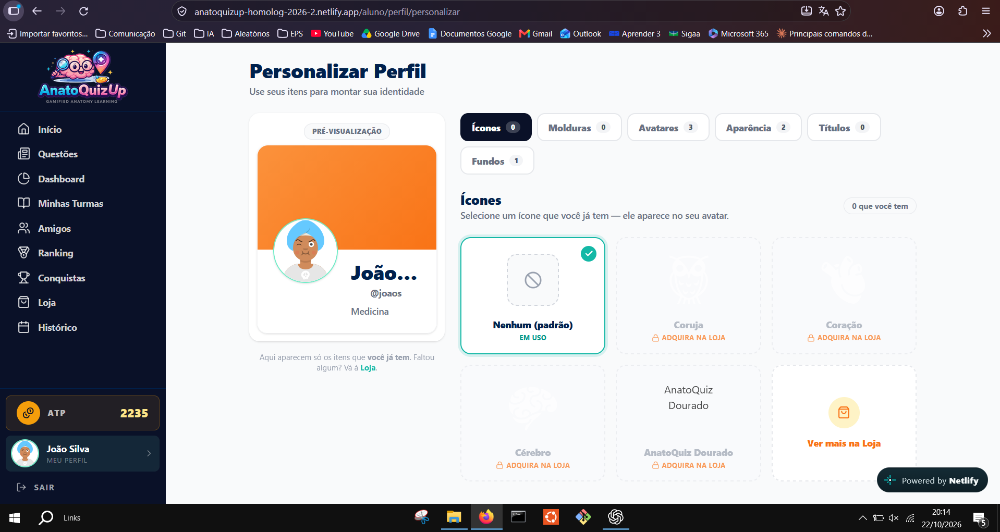

??? info "Captura 4.PNG"

    

??? info "Captura 4_1.PNG"

    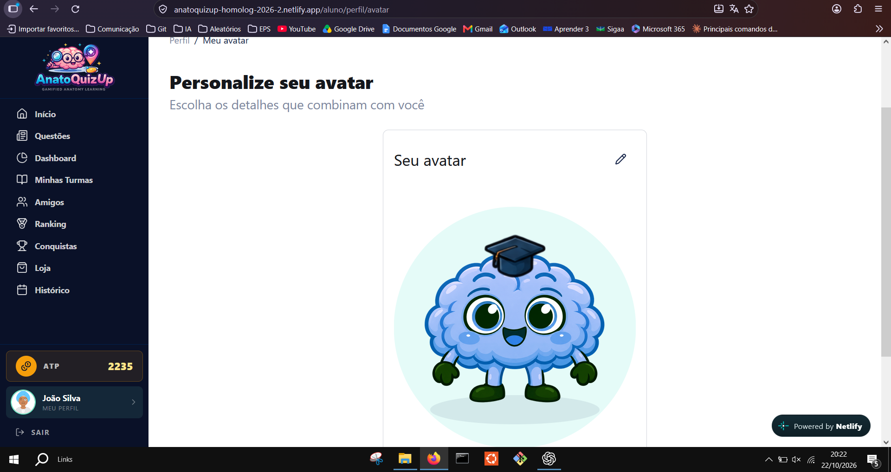

??? info "Captura 4_2.PNG"

    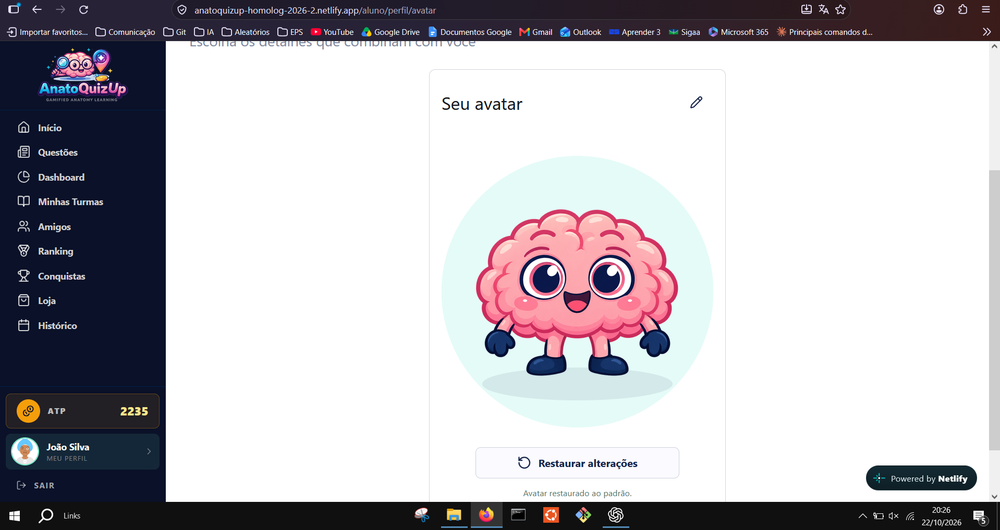

??? info "Captura 5.PNG"

    

??? info "Captura 5_1.PNG"

    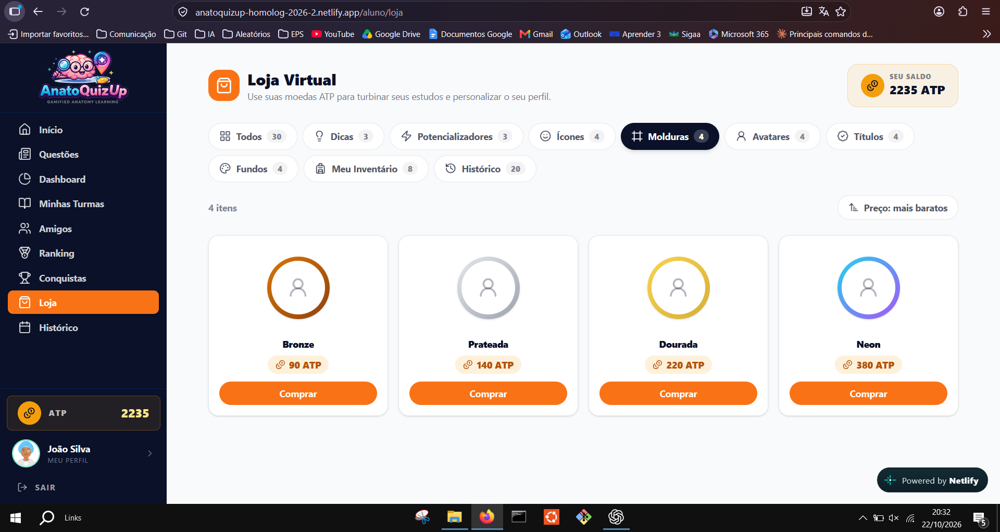

??? info "Captura 6.PNG"

    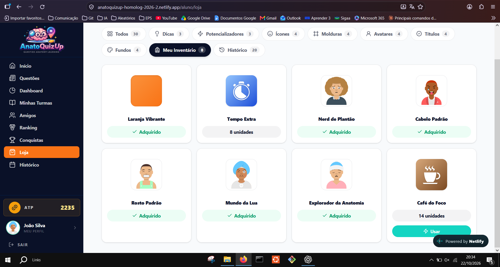

??? info "Captura 6_1.PNG"

    

??? info "Captura 6_2.PNG"

    

??? info "Captura 7.PNG"

    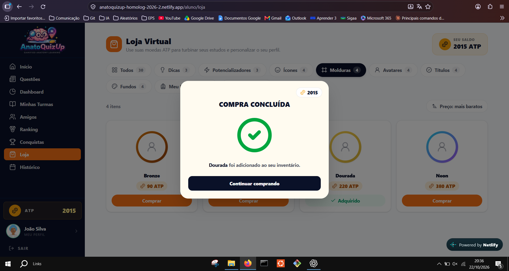

??? info "Captura 7_1.PNG"

    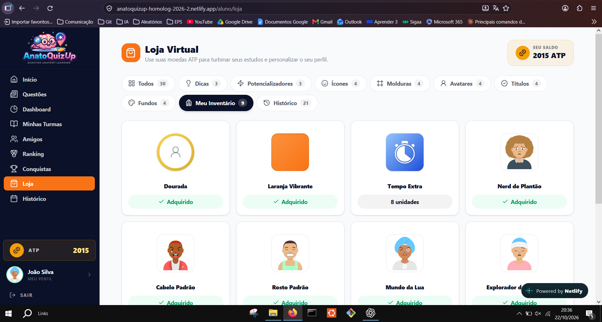

??? info "Captura 7_2.PNG"

    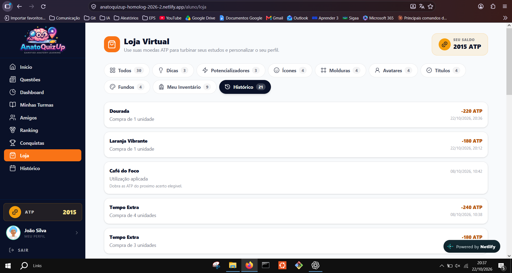

??? info "Captura 8.PNG"

    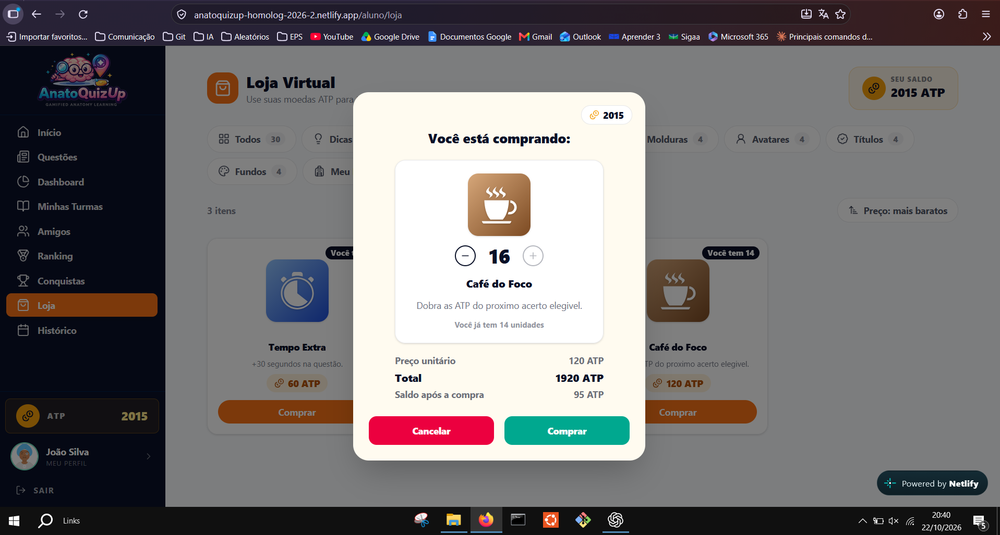

??? info "Captura 9.PNG"

    

??? info "Captura 9_1.PNG"

    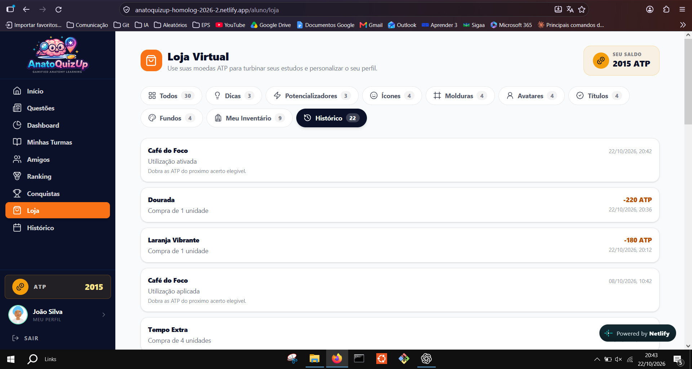

??? info "Captura 10.PNG"

    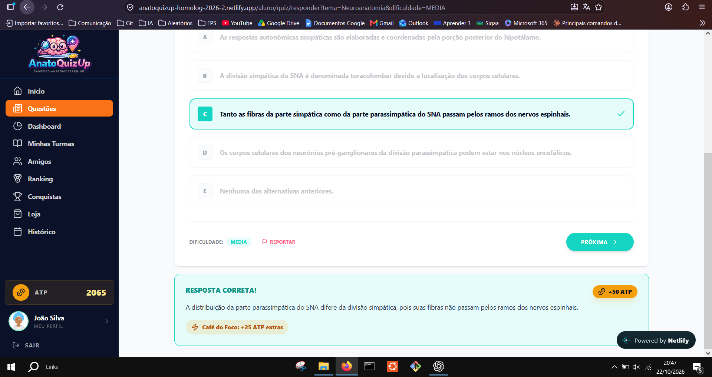

??? info "Captura 10_1.PNG"

    

??? info "Captura 11.PNG"

    

??? info "Captura 11_1.PNG"

    

??? info "Captura 11_2.PNG"

    

??? info "Captura 12.PNG"

    

??? info "Captura 12_1.PNG"

    

??? info "Captura 12_2.PNG"

    

??? info "Captura 12_3.PNG"

    

## Histórico de versão

| Data | Versão | Descrição | Autor | Revisor |
|---|---|---|---|---|
| 23/10/2026 | 1.0 | Roteiro, resultados da primeira rodada, evidências e pendências de reteste | [Brenno Oliveira](https://github.com/Brenno-Silva01) | Revisão pendente |
